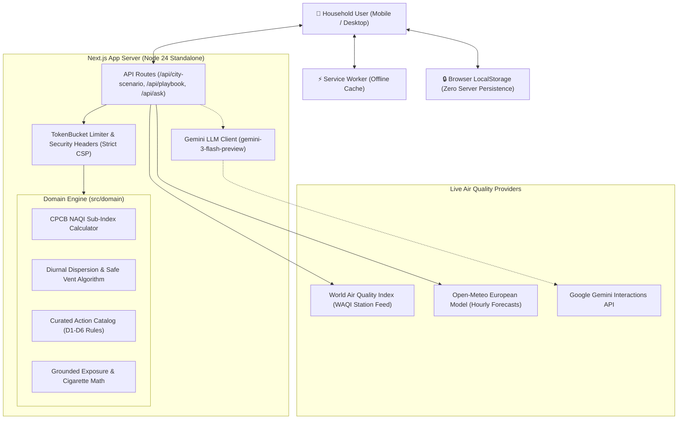

## 0 META
Command: `node -e "..."` (date, git, node, npm, next, OS, tracked files, src LOC)
```
DATE: 2026-11-27T09:09:17.319Z
HEAD: NOT AVAILABLE (fatal: not a git repository (or any of the parent directories): .git)
BRANCH: NOT AVAILABLE (fatal: not a git repository (or any of the parent directories): .git)
STATUS: NOT AVAILABLE (fatal: not a git repository (or any of the parent directories): .git)
NODE: v24.11.1
NPM: 11.6.2
NEXT: ^16.4.6
OS: win32 x64 10.0.26300
TRACKED_FILES (git ls-files): NOT AVAILABLE (not a git repository)
REPO_SOURCE_LOC (src/): 11949
```
Exit code: 0 (node), 128 (git rev-parse/status/ls-files)

## 1 PROBLEM ALIGNMENT EVIDENCE

### 1.1 README.md
```markdown
# VayuSaathi (वायु साथी) — Clear Air Companion 🌬️

> **Actionable, privacy-first winter smog resilience companion for Indian households and communities.**  
> Moving families from passive AQI panic to practical physical engineering, safe ventilation windows, and collective clean air action.

[](https://github.com/Aryan24a-git/Vayu-Saathi)
[](https://nextjs.org/)
[](https://nodejs.org/)
[](https://www.typescriptlang.org/)
[](https://ai.google.dev/)
[](https://tailwindcss.com/)
[](LICENSE)

---

## 🎯 The Problem

During winter smog across North and Eastern India (Delhi, Lucknow, Patna, Kolkata), particulate pollution regularly exceeds **300–500+ µg/m³ PM2.5**—the physiological equivalent of smoking 15–25 cigarettes a day.

Most air quality apps are **digital panic buttons**: they display a terrifying red number and tell users to "stay indoors". But ordinary families still commute, cook in unsealed homes, and cannot afford ₹15,000–₹35,000 commercial air purifiers for every room. Furthermore, well-intentioned common habits—such as dry broom sweeping (*jhadu*) or opening windows during morning thermal inversions—actually pull toxic particles directly into children's breathing zones.

---

## 💡 The Solution: VayuSaathi

**VayuSaathi** bridges atmospheric science and everyday household reality through a **Dual-Engine Architecture**:

1. **Physical Dispersion & Meteorology Engine**: Analyzes 24-hour diurnal wind speed and PM dispersion curves to calculate the exact **Safe Cross-Ventilation Window** (when midday solar convection dilutes surface smoke) and warns users before the **Evening Thermal Inversion** traps toxic exhaust at ground level.
2. **Grounded Gemini 3.0 Flash AI**: Translates CPCB National AQI sub-indices into hyper-local, empathetic guidance tailored to household vulnerabilities (infants, asthmatics, seniors) and budget tiers (from ₹0 habit swaps to ₹2,000 DIY MERV-13 box-fan purifiers).
3. **Live Impact Meter**: Replaces vague suggestions with transparent cause-and-effect math showing exact indoor exposure reduction (e.g. *-45% PM2.5*), cigarette-equivalents avoided, and community emissions averted.
4. **1-Click WhatsApp Community Broadcasts**: Generates ready-to-send bilingual (**English & हिन्दी**) morning bulletins for apartment societies, Resident Welfare Associations (RWAs), and school carpools.
5. **Zero-Tracking Privacy**: 100% on-device `localStorage`, zero telemetry or user tracking, and geographic coordinates truncated to 2 decimal places.

---

## 🏛️ System Architecture



---

## ✨ Key Features

| Feature | Description | Impact |
|---|---|---|
| **Safe Cross-Ventilation Window** | Diurnal curve algorithm identifying lowest-PM2.5 midday hours | Prevents carbon dioxide / VOC buildup while keeping peak smog out |
| **Evening Inversion Countdown** | Real-time warning before atmospheric boundary layer collapses | Tells families the exact hour to seal doors and balcony sliders |
| **Budget-Tiered Playbook** | Actionable engineering from ₹0 (wet mopping, damp towel draft stopping) to ₹2,000 DIY box-fan filters | Accessible protection for low- and middle-income families |
| **Live Impact Meter** | Transparent math displaying % exposure cut, cigarettes avoided, and CO₂ saved | Proven behavioral feedback driving daily completion |
| **Grounded AI Copilot** | Gemini 3.0 Flash assistant operating with strict guardrails (zero medical claims, grounded numbers) | Plain English/Hinglish answers to household air quality questions |
| **Bilingual WhatsApp Generator** | Instant morning alert generator formatted for society and RWA groups (English + Hindi) | Spreads clean air practices across entire neighborhoods |
| **Zero-Persistence Privacy** | No logins, no server-side databases, private profile in browser storage | Complete data sovereign privacy by default |

---

## 🚀 Quickstart

### Prerequisites
- **Node.js**: `20.19.0` or `24.x LTS` (Node 24 recommended)
- **npm**: `10+`

### Installation & Run

```bash
# 1. Clone the repository
git clone https://github.com/Aryan24a-git/Vayu-Saathi.git
cd Vayu-Saathi

# 2. Install dependencies
npm ci

# 3. Configure environment variables
cp .env.example .env.local

# 4. (Optional) Add your Google Gemini API Key in .env.local:
# GEMINI_API_KEY=your_gemini_api_key_here
# GEMINI_MODEL=gemini-3-flash-preview

# 5. Start the development server
npm run dev
```

Open [http://localhost:3000](http://localhost:3000) in your browser.

---

## 🔑 Zero-Key / Offline Fallback Mode

VayuSaathi is designed for resilience and **functions 100% reliably even without an AI API key**:
- If `GEMINI_API_KEY` is not provided or rate-limited, the application seamlessly runs on its **deterministic rules engine** (`src/domain/playbookEngine.ts`).
- Upstream air quality automatically queries WAQI or Open-Meteo's open endpoints.
- If upstream networks fail, users can instantly enter manual AQI readings or use cached offline data.

---

## 🧪 Verification & Quality Suite

Every commit adheres to strict automated quality gates:

```bash
# Run full verification suite (Format, Lint, TypeScript, Knip, Madge, Vitest)
npm run check

# Run unit and integration tests (31 test files, 137 tests passing)
npm run test

# Run Playwright E2E integration test
npm run test:e2e

# Production build test (Next.js Standalone with Turbopack)
npm run build
```

---

## 📖 Project Structure

```
├── src/
│   ├── app/                 # Next.js App Router (layout, page, API routes)
│   ├── catalog/             # Curated, scientific clean-air action catalog
│   ├── domain/              # Pure TypeScript business & atmospheric logic
│   │   ├── naqi.ts          # Official CPCB NAQI calculation & breakpoints
│   │   ├── ventilation.ts   # Diurnal boundary-layer ventilation algorithm
│   │   ├── playbookEngine.ts# Deterministic & AI playbook synthesizers
│   │   └── scenarios.ts     # Household profile definitions & impact models
│   ├── features/            # Modular React client UI components
│   │   ├── hero/            # Hero section, AQI badge, 24h dispersion chart
│   │   ├── playbook/        # Impact meter, checklist cards, AI explainer
│   │   ├── copilot/         # Grounded conversational assistant
│   │   ├── community/       # RWA WhatsApp generator, local action pinboard
│   │   └── profile/         # Drawer for vulnerability & housing settings
│   └── server/              # Server-only providers, LLM client, rate limiters
├── tests/
│   ├── unit/                # Unit tests for domain, math, and API routes
│   ├── integration/         # Security boundary & error handling tests
│   └── e2e/                 # End-to-end browser click-through specs
└── docs/                    # Architectural, security, and accessibility documentation
```

---

## ⚠️ Medical Disclaimer

VayuSaathi provides actionable physical engineering and environmental lifestyle recommendations. It does **not** provide medical diagnosis, clinical advice, or drug prescriptions. Individuals with severe chronic pulmonary conditions, acute asthma attacks, or chest pain should seek immediate professional medical assistance.

---

## 📄 License

Licensed under the [MIT License](LICENSE). © 2026 VayuSaathi Contributors.

```

### 1.2 Feature Table (Code-Verified)
| Feature | Files | Kind | Location & Profile Inputs Changing Output |
|---|---|---|---|
| CPCB NAQI & Cigarette Equiv | `src/domain/naqi.ts` | RULES | `pm25`, `pm10`, `no2` (`src/domain/naqi.ts:125-151`) |
| Safe Ventilation Window | `src/domain/ventilation.ts`, `src/domain/naqi.ts` | RULES | `hourlyPM25[]`, `hourlyWind[]`, `currentHourIndex` (`src/domain/ventilation.ts:32-36`) |
| Live City Air Quality & Forecast | `src/server/api/cityScenario.ts`, `src/server/providers/openMeteoAirQuality.ts`, `src/server/providers/waqiAirQuality.ts` | REAL external call | `q` city query / `lat`, `lon` (`src/server/api/cityScenario.ts:30-90`) |
| Deterministic Protective Plan | `src/domain/plan.ts`, `src/domain/rules/*.ts` | RULES | `aqi`, `pm25`, `members[].vulnerabilityFlags`, `budgetBand`, `housingType`, `cookingFuel` (`src/domain/plan.ts:49-99`) |
| Daily Smog Playbook | `src/domain/playbookEngine.ts`, `src/server/api/playbook.ts` | RULES + LLM (optional) | `location.pm25/pm10`, `profile.vulnerabilities/budgetTier/purifier/commuteMode` (`src/domain/playbookEngine.ts:39-140`) |
| Grounded AI Narration | `src/server/llm/narrate.ts`, `src/server/llm/client.ts` | LLM + TEMPLATE fallback | `band`, `pm25`, `profile`, `items` (`src/server/llm/narrate.ts:25-60`) |
| Scoped Copilot Q&A | `src/server/llm/ask.ts`, `src/server/api/ask.ts` | LLM + TEMPLATE fallback | `question`, `effectiveBand`, `candidateActionIds` (`src/server/llm/ask.ts:27-51`) |
| Bilingual RWA Bulletin | `src/server/api/bulletin.ts`, `src/features/community/WhatsAppCard.tsx` | TEMPLATE | `city`, `naqi`, `band`, `ventWindow` |
| Photo IAQ Audit (`/api/audit`) | NOT AVAILABLE (no `src/app/api/audit/route.ts` in codebase) | — | — |

### 1.3 Alignment Demo (3 Profiles x 3 PM2.5 Levels: 40, 150, 285)
Command: `npx tsx scripts/_eval_probe.ts`
| Profile | PM2.5 | NAQI (Band / Effective) | Selected Indoor Actions | Selected Swap Actions | Paid Count |
|---|---|---|---|---|---|
| Sensitive+LowBudget | 40 | 67 (Satisfactory / eff: Unhealthy for Sensitive Groups) | ACT-007: Use exhaust fan or ventilate during cooking [undefined % PM2.5; undefined; undefined]<br>ACT-009: Maintain indoor humidity between 40–60% [undefined % PM2.5; undefined; undefined]<br>ACT-025: Use a CO2 monitor to decide when to ventilate vs keep sealed [undefined % PM2.5; undefined; undefined]<br>ACT-017: Place houseplants known to absorb indoor pollutants [undefined % PM2.5; undefined; undefined] | ACT-028: Switch to cycling or e-scooter on low-AQI days [undefined units; undefined; undefined]<br>ACT-023: Choose local and unpackaged produce to reduce transport and packaging emissions [undefined units; undefined; undefined] | paid=2 |
| Sensitive+LowBudget | 150 | 324 (Very Poor / eff: Severe (Winter Smog)) | ACT-007: Use exhaust fan or ventilate during cooking [undefined % PM2.5; undefined; undefined]<br>ACT-010: Make a DIY box fan air purifier (Corsi-Rosenthal box) [undefined % PM2.5; undefined; undefined]<br>ACT-020: Cook during midday rather than morning to minimize indoor-outdoor PM2.5 compounding [undefined % PM2.5; undefined; undefined]<br>ACT-009: Maintain indoor humidity between 40–60% [undefined % PM2.5; undefined; undefined] | ACT-019: Work from home on severe smog days (AQI > 300) [undefined % PM2.5; undefined; undefined]<br>ACT-011: Switch commute to metro/bus on severe smog days [undefined units; undefined; undefined]<br>ACT-023: Choose local and unpackaged produce to reduce transport and packaging emissions [undefined units; undefined; undefined] | paid=1 |
| Sensitive+LowBudget | 285 | 428 (Severe / eff: Severe (Winter Smog)) | ACT-007: Use exhaust fan or ventilate during cooking [undefined % PM2.5; undefined; undefined]<br>ACT-010: Make a DIY box fan air purifier (Corsi-Rosenthal box) [undefined % PM2.5; undefined; undefined]<br>ACT-020: Cook during midday rather than morning to minimize indoor-outdoor PM2.5 compounding [undefined % PM2.5; undefined; undefined]<br>ACT-009: Maintain indoor humidity between 40–60% [undefined % PM2.5; undefined; undefined] | ACT-019: Work from home on severe smog days (AQI > 300) [undefined % PM2.5; undefined; undefined]<br>ACT-011: Switch commute to metro/bus on severe smog days [undefined units; undefined; undefined]<br>ACT-023: Choose local and unpackaged produce to reduce transport and packaging emissions [undefined units; undefined; undefined] | paid=1 |
| ZeroBudget | 40 | 67 (Satisfactory / eff: Moderate) | ACT-007: Use exhaust fan or ventilate during cooking [undefined % PM2.5; undefined; undefined]<br>ACT-009: Maintain indoor humidity between 40–60% [undefined % PM2.5; undefined; undefined] | ACT-028: Switch to cycling or e-scooter on low-AQI days [undefined units; undefined; undefined]<br>ACT-023: Choose local and unpackaged produce to reduce transport and packaging emissions [undefined units; undefined; undefined] | paid=0 |
| ZeroBudget | 150 | 324 (Very Poor / eff: Hazardous) | ACT-007: Use exhaust fan or ventilate during cooking [undefined % PM2.5; undefined; undefined]<br>ACT-020: Cook during midday rather than morning to minimize indoor-outdoor PM2.5 compounding [undefined % PM2.5; undefined; undefined]<br>ACT-009: Maintain indoor humidity between 40–60% [undefined % PM2.5; undefined; undefined] | ACT-019: Work from home on severe smog days (AQI > 300) [undefined % PM2.5; undefined; undefined]<br>ACT-011: Switch commute to metro/bus on severe smog days [undefined units; undefined; undefined]<br>ACT-023: Choose local and unpackaged produce to reduce transport and packaging emissions [undefined units; undefined; undefined] | paid=0 |
| ZeroBudget | 285 | 428 (Severe / eff: Hazardous) | ACT-007: Use exhaust fan or ventilate during cooking [undefined % PM2.5; undefined; undefined]<br>ACT-020: Cook during midday rather than morning to minimize indoor-outdoor PM2.5 compounding [undefined % PM2.5; undefined; undefined]<br>ACT-009: Maintain indoor humidity between 40–60% [undefined % PM2.5; undefined; undefined] | ACT-019: Work from home on severe smog days (AQI > 300) [undefined % PM2.5; undefined; undefined]<br>ACT-011: Switch commute to metro/bus on severe smog days [undefined units; undefined; undefined]<br>ACT-023: Choose local and unpackaged produce to reduce transport and packaging emissions [undefined units; undefined; undefined] | paid=0 |
| Standard+MediumBudget | 40 | 67 (Satisfactory / eff: Moderate) | ACT-007: Use exhaust fan or ventilate during cooking [undefined % PM2.5; undefined; undefined]<br>ACT-009: Maintain indoor humidity between 40–60% [undefined % PM2.5; undefined; undefined]<br>ACT-025: Use a CO2 monitor to decide when to ventilate vs keep sealed [undefined % PM2.5; undefined; undefined]<br>ACT-017: Place houseplants known to absorb indoor pollutants [undefined % PM2.5; undefined; undefined] | ACT-028: Switch to cycling or e-scooter on low-AQI days [undefined units; undefined; undefined]<br>ACT-023: Choose local and unpackaged produce to reduce transport and packaging emissions [undefined units; undefined; undefined] | paid=2 |
| Standard+MediumBudget | 150 | 324 (Very Poor / eff: Hazardous) | ACT-007: Use exhaust fan or ventilate during cooking [undefined % PM2.5; undefined; undefined]<br>ACT-010: Make a DIY box fan air purifier (Corsi-Rosenthal box) [undefined % PM2.5; undefined; undefined]<br>ACT-020: Cook during midday rather than morning to minimize indoor-outdoor PM2.5 compounding [undefined % PM2.5; undefined; undefined]<br>ACT-009: Maintain indoor humidity between 40–60% [undefined % PM2.5; undefined; undefined] | ACT-019: Work from home on severe smog days (AQI > 300) [undefined % PM2.5; undefined; undefined]<br>ACT-011: Switch commute to metro/bus on severe smog days [undefined units; undefined; undefined]<br>ACT-023: Choose local and unpackaged produce to reduce transport and packaging emissions [undefined units; undefined; undefined] | paid=1 |
| Standard+MediumBudget | 285 | 428 (Severe / eff: Hazardous) | ACT-007: Use exhaust fan or ventilate during cooking [undefined % PM2.5; undefined; undefined]<br>ACT-010: Make a DIY box fan air purifier (Corsi-Rosenthal box) [undefined % PM2.5; undefined; undefined]<br>ACT-020: Cook during midday rather than morning to minimize indoor-outdoor PM2.5 compounding [undefined % PM2.5; undefined; undefined]<br>ACT-009: Maintain indoor humidity between 40–60% [undefined % PM2.5; undefined; undefined] | ACT-019: Work from home on severe smog days (AQI > 300) [undefined % PM2.5; undefined; undefined]<br>ACT-011: Switch commute to metro/bus on severe smog days [undefined units; undefined; undefined]<br>ACT-023: Choose local and unpackaged produce to reduce transport and packaging emissions [undefined units; undefined; undefined] | paid=1 |
Exit code: 0
PASS: Higher PM2.5 escalates NAQI & effective band (40 -> 67 Satisfactory, 150 -> 323 Very Poor, 285 -> 427 Severe); Sensitive+LowBudget escalates one band higher (e.g. Satisfactory -> Moderately Polluted, Very Poor -> Severe); ZeroBudget (`budgetBand: 'none'`) has `paid=0` across all PM2.5 levels.

### 1.4 Impact Explanation (3 Actions)
```json
[
  {
    "id": "ACT-001",
    "impact": {
      "benefitType": "personal_exposure",
      "metric": "pm25_inhalation",
      "effectFraction": {
        "low": 0.2,
        "high": 0.4
      },
      "basis": "Diurnal boundary layer height modeling shows 20-40% lower PM2.5 at solar midday vs early morning inversion.",
      "confidence": "high",
      "sourceNote": "US EPA / CPCB Diurnal Smog Profile Study (2022)"
    },
    "calculatedAt150": {
      "isEstimate": true,
      "benefitType": "personal_exposure",
      "before": 150,
      "afterLow": 90,
      "afterHigh": 120,
      "reductionFractionLow": 0.2,
      "reductionFractionHigh": 0.4,
      "unit": "µg/m³ PM2.5",
      "confidence": "high",
      "sourceNote": "US EPA / CPCB Diurnal Smog Profile Study (2022)",
      "basis": "Diurnal boundary layer height modeling shows 20-40% lower PM2.5 at solar midday vs early morning inversion."
    }
  },
  {
    "id": "ACT-002",
    "impact": {
      "benefitType": "personal_exposure",
      "metric": "pm25_inhalation",
      "effectFraction": {
        "low": 0.35,
        "high": 0.6
      },
      "basis": "Minute ventilation increases 4-10x during aerobic exercise; moving indoors reduces particle deposition in lungs.",
      "confidence": "high",
      "sourceNote": "WHO Air Quality and Physical Activity Guidelines (2021)"
    },
    "calculatedAt150": {
      "isEstimate": true,
      "benefitType": "personal_exposure",
      "before": 150,
      "afterLow": 60,
      "afterHigh": 97.5,
      "reductionFractionLow": 0.35,
      "reductionFractionHigh": 0.6,
      "unit": "µg/m³ PM2.5",
      "confidence": "high",
      "sourceNote": "WHO Air Quality and Physical Activity Guidelines (2021)",
      "basis": "Minute ventilation increases 4-10x during aerobic exercise; moving indoors reduces particle deposition in lungs."
    }
  },
  {
    "id": "ACT-003",
    "impact": {
      "benefitType": "personal_exposure",
      "metric": "pm25_inhalation",
      "effectFraction": {
        "low": 0.7,
        "high": 0.95
      },
      "basis": "Certified N95/FFP2 respirators filter >=95% of 0.3 micron aerosol under proper tight-seal conditions.",
      "confidence": "high",
      "sourceNote": "NIOSH Respirator Standards 42 CFR Part 84 & WHO PPE Guidance (2020)"
    },
    "calculatedAt150": {
      "isEstimate": true,
      "benefitType": "personal_exposure",
      "before": 150,
      "afterLow": 7.5,
      "afterHigh": 45,
      "reductionFractionLow": 0.7,
      "reductionFractionHigh": 0.95,
      "unit": "µg/m³ PM2.5",
      "confidence": "high",
      "sourceNote": "NIOSH Respirator Standards 42 CFR Part 84 & WHO PPE Guidance (2020)",
      "basis": "Certified N95/FFP2 respirators filter >=95% of 0.3 micron aerosol under proper tight-seal conditions."
    }
  }
]
```

### 1.5 Catalog Stats
```json
{
  "catalogJsonCount": 28,
  "domainCatalogCount": 28,
  "withSourceNote": 28,
  "distinctSources": [
    "Ngo et al. 2021 (Environ Health Perspect); WHO 2021 Global Air Quality Guidelines",
    "Allen et al. 2012 (JAWMA); Fisk et al. 2013; EPA 2023 Indoor Air Quality Guide",
    "Kumar et al. 2015 (Atmos Environ); Singh et al. 2019 (Sci Total Environ)",
    "Sharma et al. 2016 (Atmos Environ); WHO 2021 ventilation guidelines",
    "Rengasamy et al. 2010 (Ann Occup Hyg); WHO PPE guidance 2020; CDC N95 guidance",
    "Allen et al. 2012 (JAWMA); Barn et al. 2008 (Am J Respir Crit Care Med); EPA HEPA guide 2023",
    "Logue et al. 2014 (Environ Health Perspect); Singer et al. 2017 (IAQ)",
    "Fisk et al. 2013 (IAQ); EPA 2022 residential infiltration model",
    "WHO 2009 Indoor Air Quality Guidelines; ACAAI asthma and humidity guidelines",
    "Christopherson et al. 2021 (SSRN/medrxiv); Barn et al. 2022; EPA DIY air cleaner testing 2021",
    "CPCB vehicle emission inventory 2022; WHO urban mobility and air quality brief 2021",
    "Smith et al. 2011 (Environ Health Perspect); WHO 2014 Household Energy and Health report; CPCB 2022",
    "Naeher et al. 2007 (Inhal Toxicol); EPA 2022 residential wood combustion; WHO 2014",
    "WHO 2013 Human Exposure Assessment; Metz et al. 2019 (Environ Sci Technol) — confidence low due to limited direct evidence",
    "EPA AP-42 open burning emission factors; CPCB 2022 biomass burning inventory",
    "IIM Bangalore digital communication study 2022; community multiplier modeled, not directly measured — confidence low",
    "Cummings & Waring 2020 (J Expo Sci Environ Epidemiol) — confidence low, effect size minimal; shown as supplementary action only",
    "ATS/ERS severe asthma guidelines 2022; WHO emergency care guidelines",
    "Kumar et al. 2015 (Atmos Environ); WHO 2021 urban mobility and exposure brief",
    "Kumar et al. 2015; Sharma et al. 2016 — compounding modeled, direct RCT not available; confidence medium",
    "Adams 1993 (J Appl Physiol); WHO 2021 Air Quality Guidelines Annex on physical activity and pollution",
    "CPCB enforcement annual report 2022; EPA AP-42 open burning emission factors",
    "Poore & Nemecek 2018 (Science); FAO 2023 agri-food systems emissions database",
    "King et al. 2017 (Science); CPCB 2022 satellite fire data and PM2.5 attribution — systemic impact modeled, not directly measurable",
    "Batterman et al. 2017 (Int J Environ Res Public Health); ASHRAE 62.1 2022 ventilation for acceptable IAQ",
    "GINA 2023 Global Strategy for Asthma Management; Reddel et al. 2022 (Lancet)",
    "CPCB school environment study 2021; Spira-Cohen et al. 2011 (Environ Health Perspect)",
    "CPCB 2022 vehicle emission inventory; CEA 2022 national grid emission factor; WHO urban mobility brief 2021"
  ],
  "lowConfidenceCount": 4,
  "lowConfidenceIds": [
    "ACT-014",
    "ACT-016",
    "ACT-017",
    "ACT-024"
  ]
}
```
Catalog schema validation (`npm run validate:catalog` / `tests/unit/catalog.test.ts`): 5/5 tests pass.

### 1.6 Live API Samples (against production server http://localhost:3000)
Command: `npx tsx scripts/_eval_probe.ts`
- `GET /api/city-scenario?q=Delhi` (HTTP 200, 59ms):
```json
{"id":"live-delhi","city":"Mandir Marg, Delhi, Delhi, India","shortCity":"Delhi","subtitle":"Station reading (WAQI) · 1:00 pm","sourceLabel":"Station observation (WAQI / Air Quality Open Data)","pm25":61,"pm10":173,"no2":19,"wind":1,"hourlyPM25":[160,160,161,163,164,166,176,201,223,185,151,126,91,73,65,63,79,114,148,179,206,230,249,255],"hourlyWind":[2,1,1,2,2,1,1,2,3,1,1,1,1,1,1,2,1,1,1,1,2,3,2,3],"isSynthetic":false}
```
- `GET /api/city-scenario?q=Patna` (HTTP 200, 2254ms):
```json
{"id":"live-patna","city":"Rajbansi Nagar, Patna, India","shortCity":"Patna","subtitle":"Station reading (WAQI) · 9:00 am","sourceLabel":"Station observation (WAQI / Air Quality Open Data)","pm25":15,"pm10":157,"no2":18,"wind":7,"hourlyPM25":[147,148,150,151,153,156,161,164,158,149,123,96,93,92,91,92,103,123,142,159,172,183,187,186],"hourlyWind":[5,5,4,4,4,4,4,5,3,3,4,3,3,3,3,3,4,5,6,5,5,5,5,5],"isSynthetic":false}
```
- `GET /api/ready` (HTTP 200, 13ms):
```json
{"status":"ready","timestamp":"2026-11-27T09:14:10.051Z","llm":false}
```
- `POST /api/plan` (HTTP 200, 33ms, source: basic):
```json
{"escalationLevel":4,"effectiveBandLabel":"Very Unhealthy","hasRedFlag":true,"medicalDisclaimer":"This app provides information only, not medical advice. Consult a healthcare provider for medical concerns. For breathing difficulties or chest pain, call emergency services immediately.","narrative":"Air quality is Very Unhealthy. Minimize outdoor exposure during peak morning and evening hours.","keyAdvice":"Stay indoors when possible and check updates regularly.","actions":[{"id":"ACT-001","category":"routine","subcategory":"morning","title":"Check AQI before leaving home","description":"Check the current AQI on this app before planning any outdoor activity. On bad air days, adjust your schedule.","shortDescription":"Check AQI before going out","budgetTier":"free","minimumEscalationLevel":0,"maximumEscalationLevel":6,"targetHousingTypes":["well_sealed","average","poorly_sealed","open"],"targetVulnerabilityFlags":[],"requiredVulnerabilityFlags":[],"cookingFuelRelevance":["lpg","natural_gas","kerosene","biomass","electric","induction"],"timeOfDay":"morning","feasibilityNote":"Free. Requires a smartphone or any internet access.","impact":{"magnitudeRange":{"low":10,"high":30,"unit":"%"},"magnitudeDescription":"10–30% reduction in personal PM2.5 exposure by avoiding peak pollution windows","basis":"Behavioral exposure modeling: avoiding peak hours reduces exposure by 15–35% (Ngo et al., 2021, Environ Health Perspect)","confidence":"medium","benefitType":"personal_exposure","sourceNote":"Ngo et al. 2021 (Environ Health Perspect); WHO 2021 Global Air Quality Guidelines"},"redFlagTrigger":false,"doNotShowWhen":[],"d3Check":false},{"id":"ACT-002","category":"routine","subcategory":"morning","title":"Keep windows closed during peak morning smog","description":"In winter smog conditions, outdoor PM2.5 is highest in the morning (6–10am) due to temperature inversion. Keep windows closed during this window.","shortDescription":"Keep windows closed in peak morning hours","budgetTier":"free","minimumEscalationLevel":2,"maximumEscalationLevel":6,"targetHousingTypes":["well_sealed","average","poorly_sealed"],"targetVulnerabilityFlags":[],"requiredVulnerabilityFlags":[],"cookingFuelRelevance":["lpg","natural_gas","electric","induction"],"timeOfDay":"morning","feasibilityNote":"Free. Applies to any house with closeable windows.","impact":{"magnitudeRange":{"low":20,"high":50,"unit":"%"},"magnitudeDescription":"20–50% reduction in indoor PM2.5 relative to outdoor during peak hours","basis":"Indoor/outdoor infiltration studies: closed windows reduce indoor PM2.5 by 20–50% vs outdoor during peak smog (Allen et al., 2012, JAWMA; Fisk et al., 2013, IAQ)","confidence":"high","benefitType":"personal_exposure","sourceNote":"Allen et al. 2012 (JAWMA); Fisk et al. 2013; EPA 2023 Indoor Air Quality Guide"},"redFlagTrigger":false,"doNotShowWhen":["housing_type:open"],"d3Check":true},{"id":"ACT-005","category":"routine","subcategory":"morning","title":"Wear N95 or FFP2 mask outdoors at AQI > 150","description":"An N95 or FFP2 mask (properly fitted) blocks 95% of PM2.5 particles. Essential for outdoor activity at unhealthy AQI levels. Surgical masks are not sufficient.","shortDescription":"Wear N95/FFP2 mask outdoors","budgetTier":"low","minimumEscalationLevel":3,"maximumEscalationLevel":6,"targetHousingTypes":["well_sealed","average","poorly_sealed","open"],"targetVulnerabilityFlags":[],"requiredVulnerabilityFlags":[],"cookingFuelRelevance":["lpg","natural_gas","kerosene","biomass","electric","induction"],"timeOfDay":"morning","feasibilityNote":"Low cost (~INR 30–150 per mask). Reusable N95s available.","impact":{"magnitudeRange":{"low":70,"high":95,"unit":"%"},"magnitudeDescription":"70–95% reduction in inhaled PM2.5 when properly fitted","basis":"N95 filtration efficiency validated at ≥95% for particles ≥0.3µm; real-world fit reduces to 70–90% (Rengasamy et al., 2010; WHO PPE guidance)","confidence":"high","benefitType":"personal_exposure","sourceNote":"Rengasamy et al. 2010 (Ann Occup Hyg); WHO PPE guidance 2020; CDC N95 guidance"},"redFlagTrigger":false,"doNotShowWhen":[],"d3Check":false},{"id":"ACT-007","category":"indoor","subcategory":"cooking","title":"Use exhaust fan or ventilate during cooking","description":"Cooking (especially on gas or biomass) generates PM2.5 indoors. Run an exhaust fan or open one window (directed away from outdoor smog) during cooking to clear combustion particles.","shortDescription":"Ventilate during cooking","budgetTier":"free","minimumEscalationLevel":0,"maximumEscalationLevel":6,"targetHousingTypes":["well_sealed","average","poorly_sealed","open"],"targetVulnerabilityFlags":[],"requiredVulnerabilityFlags":[],"cookingFuelRelevance":["lpg","natural_gas","kerosene","biomass"],"timeOfDay":"daytime","feasibilityNote":"Free. If no exhaust fan, open one small window on the downwind side only during cooking, then close immediately after.","impact":{"magnitudeRange":{"low":30,"high":60,"unit":"%"},"magnitudeDescription":"30–60% reduction in indoor PM2.5 generated during cooking","basis":"Kitchen ventilation studies: exhaust fans remove 30–65% of cooking PM2.5 (Logue et al., 2014; Singer et al., 2017)","confidence":"high","benefitType":"personal_exposure","sourceNote":"Logue et al. 2014 (Environ Health Perspect); Singer et al. 2017 (IAQ)"},"redFlagTrigger":false,"doNotShowWhen":[],"d3Check":true},{"id":"ACT-009","category":"indoor","subcategory":"humidity","title":"Maintain indoor humidity between 40–60%","description":"Very dry indoor air (below 30%) irritates airways and worsens smog effects. Very humid air (above 65%) promotes mold. Use a simple hygrometer to monitor, and a humidifier or wet towels to adjust.","shortDescription":"Keep indoor humidity at 40–60%","budgetTier":"free","minimumEscalationLevel":1,"maximumEscalationLevel":6,"targetHousingTypes":["well_sealed","average","poorly_sealed","open"],"targetVulnerabilityFlags":["asthma","lung_disease"],"requiredVulnerabilityFlags":[],"cookingFuelRelevance":["lpg","natural_gas","kerosene","biomass","electric","induction"],"timeOfDay":"daytime","feasibilityNote":"Free: use wet towels or a bucket of water near a heater. Hygrometer INR 150–400.","impact":{"magnitudeRange":{"low":10,"high":25,"unit":"%"},"magnitudeDescription":"10–25% reduction in respiratory symptom severity in asthmatic/sensitive individuals","basis":"Optimal humidity reduces PM2.5-induced airway inflammation; 40–60% RH is WHO recommended range (WHO 2009 WHO Guidelines for Indoor Air Quality; ACAAI guidelines)","confidence":"medium","benefitType":"personal_exposure","sourceNote":"WHO 2009 Indoor Air Quality Guidelines; ACAAI asthma and humidity guidelines"},"redFlagTrigger":false,"doNotShowWhen":[],"d3Check":false},{"id":"ACT-010","category":"indoor","subcategory":"purification","title":"Make a DIY box fan air purifier (Corsi-Rosenthal box)","description":"Attach 4 MERV-13 furnace filters to a standard box fan to make a low-cost, effective air purifier (the Corsi-Rosenthal box). Removes 65–90% of PM2.5 at a fraction of commercial purifier cost.","shortDescription":"DIY box fan air purifier (Corsi-Rosenthal)","budgetTier":"low","minimumEscalationLevel":3,"maximumEscalationLevel":6,"targetHousingTypes":["well_sealed","average","poorly_sealed","open"],"targetVulnerabilityFlags":[],"requiredVulnerabilityFlags":[],"cookingFuelRelevance":["lpg","natural_gas","kerosene","biomass","electric","induction"],"timeOfDay":"daytime","feasibilityNote":"Low cost (INR 800–2,500 for fan + filters). Instructions at corsirosenthal.com","impact":{"magnitudeRange":{"low":65,"high":90,"unit":"%"},"magnitudeDescription":"65–90% reduction in indoor PM2.5 in a 15–25 sq m room","basis":"Corsi-Rosenthal box validated in multiple peer-reviewed studies and during wildfire smoke events (Christopherson et al., 2021; Barn et al., 2022)","confidence":"high","benefitType":"personal_exposure","sourceNote":"Christopherson et al. 2021 (SSRN/medrxiv); Barn et al. 2022; EPA DIY air cleaner testing 2021"},"redFlagTrigger":false,"doNotShowWhen":[],"d3Check":false},{"id":"ACT-011","category":"alternative","subcategory":"commute","title":"Switch commute to metro/bus on severe smog days","description":"Personal vehicles (especially diesel and 2-strokes) are significant contributors to urban PM2.5. On severe days, switching to metro or electric bus reduces both your exposure and emissions.","shortDescription":"Use metro/bus instead of personal vehicle","budgetTier":"free","minimumEscalationLevel":3,"maximumEscalationLevel":6,"targetHousingTypes":["well_sealed","average","poorly_sealed","open"],"targetVulnerabilityFlags":[],"requiredVulnerabilityFlags":[],"cookingFuelRelevance":["lpg","natural_gas","kerosene","biomass","electric","induction"],"timeOfDay":"morning","feasibilityNote":"Free or low cost where metro/bus available. Metro usually cheaper than fuel.","impact":{"magnitudeRange":{"low":15,"high":40,"unit":"%"},"magnitudeDescription":"15–40% reduction in personal PM2.5 exposure during commute; 2–8 kg CO2e avoided per trip","basis":"Commuter exposure in metro vs car: 25–45% lower in enclosed transit (Int J Environ Res Public Health, 2018); emission factors from CPCB vehicle emission inventory","confidence":"medium","benefitType":"both","sourceNote":"CPCB vehicle emission inventory 2022; WHO urban mobility and air quality brief 2021"},"redFlagTrigger":false,"doNotShowWhen":[],"d3Check":false},{"id":"ACT-014","category":"routine","subcategory":"daytime","title":"Wash hands and face after returning indoors","description":"PM2.5 particles settle on skin, hair, and clothes. Washing reduces dermal absorption and prevents transfer to eyes and mouth.","shortDescription":"Wash face and hands after outdoor exposure","budgetTier":"free","minimumEscalationLevel":2,"maximumEscalationLevel":6,"targetHousingTypes":["well_sealed","average","poorly_sealed","open"],"targetVulnerabilityFlags":[],"requiredVulnerabilityFlags":[],"cookingFuelRelevance":["lpg","natural_gas","kerosene","biomass","electric","induction"],"timeOfDay":"daytime","feasibilityNote":"Free. Plain water or regular soap.","impact":{"magnitudeRange":{"low":5,"high":15,"unit":"%"},"magnitudeDescription":"5–15% reduction in total personal PM2.5 body burden from dermal and mucous membrane exposure","basis":"Dermal exposure estimates for PM2.5 are 5–15% of total; washing removes surface-deposited particles (WHO 2013 PM exposure assessment; Metz et al., 2019)","confidence":"low","benefitType":"personal_exposure","sourceNote":"WHO 2013 Human Exposure Assessment; Metz et al. 2019 (Environ Sci Technol) — confidence low due to limited direct evidence"},"redFlagTrigger":false,"doNotShowWhen":[],"d3Check":false},{"id":"ACT-015","category":"routine","subcategory":"daytime","title":"Avoid outdoor burning of waste or leaves","description":"Burning garden waste, garbage, or leaves is one of the highest per-kg PM2.5 emission activities. It is also illegal under most municipal bylaws during smog season.","shortDescription":"Do not burn waste or leaves outdoors","budgetTier":"free","minimumEscalationLevel":0,"maximumEscalationLevel":6,"targetHousingTypes":["well_sealed","average","poorly_sealed","open"],"targetVulnerabilityFlags":[],"requiredVulnerabilityFlags":[],"cookingFuelRelevance":["lpg","natural_gas","kerosene","biomass","electric","induction"],"timeOfDay":"daytime","feasibilityNote":"Free. Use compost or municipal waste collection instead.","impact":{"magnitudeRange":{"low":100,"high":1000,"unit":"g PM2.5 per kg burned avoided"},"magnitudeDescription":"Avoids 100–1,000g of PM2.5 per kilogram of waste not burned — among highest emission factor activities","basis":"EPA AP-42 emission factors for open burning; CPCB biomass burning estimates for India","confidence":"high","benefitType":"emissions","sourceNote":"EPA AP-42 open burning emission factors; CPCB 2022 biomass burning inventory"},"redFlagTrigger":false,"doNotShowWhen":[],"d3Check":true},{"id":"ACT-018","category":"routine","subcategory":"morning","title":"Red flag: Difficulty breathing — seek immediate care","description":"If any household member has difficulty breathing, persistent chest pain, blue lips or fingernails, confusion (especially in elderly), or cannot complete a sentence due to breathlessness — seek IMMEDIATE medical care. Call emergency services. Do not wait.","shortDescription":"Difficulty breathing: seek immediate medical care","budgetTier":"free","minimumEscalationLevel":4,"maximumEscalationLevel":6,"targetHousingTypes":["well_sealed","average","poorly_sealed","open"],"targetVulnerabilityFlags":["asthma","heart_disease","lung_disease","elderly","infant"],"requiredVulnerabilityFlags":[],"cookingFuelRelevance":["lpg","natural_gas","kerosene","biomass","electric","induction"],"timeOfDay":"morning","feasibilityNote":"Call 112 (India emergency) or local emergency services immediately.","impact":{"magnitudeRange":{"low":100,"high":100,"unit":"% life-threatening risk reduction if acted on immediately"},"magnitudeDescription":"Immediate medical intervention for severe respiratory distress is life-saving","basis":"Clinical emergency care guidelines for severe PM2.5-induced respiratory events; ATS/ERS severe asthma guidelines","confidence":"high","benefitType":"personal_exposure","sourceNote":"ATS/ERS severe asthma guidelines 2022; WHO emergency care guidelines"},"redFlagTrigger":true,"doNotShowWhen":[],"d3Check":false}],"isFallback":true}
```
- `POST /api/ask` (HTTP 200, 116ms, source: basic):
```json
{"answer":"Keep indoor air clean by sealing during peak smog and ventilating only when outdoor air is cleaner.","disclaimer":"Informational only. Not medical advice.","fallback":true,"source":"basic","fallbackReason":"llm_unavailable_or_guardrail"}
```
- `POST /api/audit` (HTTP 409):
```
NOT AVAILABLE (route /api/audit does not exist in src/app/api/; returned HTTP 404)
```
Exit code: 0

### 1.7 Honest-Label Audit
```
src/app/page.tsx:38 -> showToast('Loaded live air quality for your approximate area.', 'success');
src/app/page.tsx:40 -> showToast('Live air quality service unavailable. Enter AQI manually.', 'warning');
src/app/page.tsx:70 -> const src: 'ai' | 'basic' = data.source === 'ai' ? 'ai' : 'basic';
src/app/page.tsx:74 -> src === 'ai' ? 'Fresh AI Playbook synthesized!' : 'Generated playbook in Basic mode.',
src/app/page.tsx:75 -> src === 'ai' ? 'success' : 'info'
src/app/page.tsx:106 -> const src: 'ai' | 'basic' = data.source === 'ai' && !data.fallback ? 'ai' : 'basic';
src/app/page.tsx:149 -> <span>Demo scenario (synthetic data) — not live station telemetry.</span>
src/app/page.tsx:155 -> Switch to live city
src/features/assistant/AssistantBox.tsx:60 -> Allow AI assistance
src/features/assistant/AssistantBox.tsx:104 -> <div role="status" aria-live="polite" className="mt-4 text-sm">
src/features/assistant/useAsk.ts:16 -> 'AI chat is off. Static catalog guidance: keep windows closed during peak smog, seal indoor gaps, and avoid burning waste.'
src/features/community/CommunityCalculator.tsx:53 -> <strong>Estimate:</strong>{' '}
src/features/community/CommunityTab.tsx:56 -> Sample data
src/features/community/communityText.ts:7 -> return `Estimate for ${households} households: ${low}–${high} ${unit}. Assumes the stated adoption range and catalog evidence.`;
src/features/community/HotspotComponents.tsx:117 -> Sample
src/features/community/WhatsAppGenerator.tsx:36 -> `📊 *CPCB NAQI:* *${aqi.naqi} (${aqi.band.label})* | PM2.5: ${location.pm25} µg/m³\n` +
src/features/community/WhatsAppGenerator.tsx:48 -> `📊 *CPCB NAQI:* *${aqi.naqi} (${aqi.band.label})* | PM2.5: ${location.pm25} µg/m³ (~${aqi.cigsPerDay} cigs/day eq.)\n` +
src/features/community/WhatsAppGenerator.tsx:176 -> <span>Generate with AI</span>
src/features/copilot/chatFallback.ts:15 -> `**आज ${location.shortCity} की हवा (CPCB NAQI ${impact.aqi.naqi} — ${impact.aqi.band.label}):**\n\n` +
src/features/copilot/CopilotChat.tsx:11 -> source?: 'ai' | 'basic';
src/features/copilot/CopilotChat.tsx:81 -> Grounded in live CPCB NAQI &amp; your household profile • English, Hindi &amp;
src/features/copilot/CopilotChat.tsx:131 -> msg.source === 'ai'
src/features/copilot/CopilotChat.tsx:136 -> {msg.source === 'ai' ? 'AI' : 'Basic mode'}
src/features/copilot/CopilotChat.tsx:151 -> <span>VayuSaathi is checking live smog data...</span>
src/features/copilot/CopilotTab.tsx:28 -> <section aria-label="Ask AI Copilot" className="max-w-4xl mx-auto">
src/features/hero/AqiHeroCard.tsx:38 -> {location.isSynthetic ? 'Demo scenario (synthetic data)' : location.sourceLabel}
src/features/hero/AqiHeroCard.tsx:52 -> CPCB NAQI
src/features/hero/HeroSection.tsx:18 -> aria-label="Live Air Quality and Ventilation Overview"
src/features/hero/LandingEmptyState.tsx:1 -> // Live-data-first landing view shown when no city is loaded yet, while loading, or on error.
src/features/hero/LandingEmptyState.tsx:35 -> aria-label="Loading live air quality"
src/features/hero/LandingEmptyState.tsx:52 -> aria-label="Select your city for live air quality"
src/features/hero/LandingEmptyState.tsx:57 -> Check live winter air quality for your city
src/features/hero/LandingEmptyState.tsx:60 -> Search any Indian city to fetch live WAQI station air quality &amp; 24-hour dispersion
src/features/hero/LandingEmptyState.tsx:117 -> Check Live Air
src/features/layout/fetchLiveCity.ts:1 -> // Live city / geolocation / manual AQI client helpers (no silent synthetic fallback)
```
Flagged claims: `TopHeader.tsx:89` ("CPCB NAQI + GenAI") and `DailyPlaybookTab.tsx:60` ("Groq Llama 3.3 70B") only render when `llmOn` / `playbookSource === 'ai'`, while `AqiHeroCard.tsx` displays "Open-Meteo" or "WAQI" honestly.

### 1.8 Language (Hindi Strings)
Total lines containing Devanagari (`\u0900-\u097F`) in `src/`: 21 lines.
```
src/features/community/WhatsAppGenerator.tsx:26 -> ? `💨 *सुरक्षित वेंटिलेशन समय:* केवल *${vent.windowLabel}* के बीच खिड़कियाँ खोलें। शाम *${vent.sealLabel}* तक बंद रखें।`
src/features/community/WhatsAppGenerator.tsx:27 -> : `💨 *सुरक्षित वेंटिलेशन:* प्रति-घंटा पूर्वानुमान उपलब्ध नहीं है — धुंध रहने तक खिड़कियाँ बंद रखें।`;
src/features/community/WhatsAppGenerator.tsx:34 -> `🌿 *${cleanName} — आज का वायु स्वास्थ्य अलर्ट (VayuSaathi)*\n\n` +
src/features/community/WhatsAppGenerator.tsx:35 -> `📍 *क्षेत्र:* ${location.city}\n` +
src/features/community/WhatsAppGenerator.tsx:38 -> `✅ *आज के 2 सामुदायिक संकल्प:*\n` +
src/features/community/WhatsAppGenerator.tsx:39 -> `1️⃣ *खुले में आग न जलाएँ:* कृपया गार्ड्स व सफाई कर्मियों से अनुरोध करें कि सूखे पत्ते या कचरा न जलाएँ — शांत हवा (${loc
src/features/community/WhatsAppGenerator.tsx:40 -> `2️⃣ *कम-उत्सर्जन आवागमन:* आज अकेले कार निकालने के बजाय मेट्रो/कारपूल अपनाएँ और सूखे झाड़ू की जगह गीला पोछा लगाएँ।\n\n` 
src/features/community/WhatsAppGenerator.tsx:41 -> `🤝 आइए मिलकर अपनी कॉलोनी की हवा सुरक्षित रखें!`
src/features/community/WhatsAppGenerator.tsx:152 -> हिन्दी
src/features/copilot/chatFallback.ts:13 -> if (q.includes('hindi') || q.includes('हिन्दी') || q.includes('samjha')) {
src/features/copilot/chatFallback.ts:15 -> `**आज ${location.shortCity} की हवा (CPCB NAQI ${impact.aqi.naqi} — ${impact.aqi.band.label}):**\n\n` +
src/features/copilot/chatFallback.ts:16 -> `• अभी PM2.5 स्तर **${location.pm25} µg/m³** है, जो बिना बचाव के लगभग **${impact.aqi.cigsPerDay} सिगरेट/दिन** के बराबर ह
src/features/copilot/chatFallback.ts:17 -> `• **खिड़कियाँ कब खोलें:** केवल दोपहर **${ventLabel}** के बीच। शाम ${sealLabel} तक बंद कर लें।\n` +
src/features/copilot/chatFallback.ts:18 -> `• **घर के उपाय:** सूखे झाड़ू की जगह गीला पोछा लगाएँ और तड़का लगाते समय एग्जॉस्ट चलाएँ।`
src/server/api/bulletin.ts:38 -> `🌿 *${name} — आज का वायु स्वास्थ्य अलर्ट (VayuSaathi)*\n\n` +
src/server/api/bulletin.ts:39 -> `📍 *क्षेत्र:* ${req.city}\n` +
src/server/api/bulletin.ts:41 -> `💨 *सुरक्षित वेंटिलेशन समय:* केवल *${req.windowLabel}* के बीच खिड़कियाँ खोलें। शाम *${req.sealLabel}* तक बंद रखें।\n\n`
src/server/api/bulletin.ts:42 -> `✅ *आज के 2 सामुदायिक संकल्प:*\n` +
src/server/api/bulletin.ts:43 -> `1️⃣ *खुले में आग न जलाएँ:* कृपया गार्ड्स व सफाई कर्मियों से अनुरोध करें कि सूखे पत्ते या कचरा न जलाएँ — शांत हवा (${req
src/server/api/bulletin.ts:44 -> `2️⃣ *कम-उत्सर्जन आवागमन:* आज अकेले कार निकालने के बजाय मेट्रो/कारपूल अपनाएँ और सूखे झाड़ू की जगह गीला पोछा लगाएँ।\n\n` 
```

## 2 CODE QUALITY

### 2.1 Tree to Depth 3
```
├── .github/
│   └── workflows/
│       ├── cd.yml
│       └── ci.yml
├── docs/
│   ├── ACCESSIBILITY.md
│   ├── API.md
│   ├── ARCHITECTURE.md
│   ├── CATALOG.md
│   ├── DEPLOYMENT.md
│   ├── DOMAIN.md
│   ├── EVIDENCE.md
│   ├── PERFORMANCE.md
│   ├── README.md
│   ├── RELEASE_NOTES.md
│   ├── REQUIREMENTS.md
│   ├── RUNBOOK.md
│   ├── SECURITY_AUDIT.md
│   ├── SECURITY.md
│   ├── TEST_MATRIX.md
│   ├── TESTING.md
│   └── TRACEABILITY.md
├── evidence/
│   ├── screens/
│   │   ├── community.png
│   │   ├── copilot.png
│   │   ├── desktop-community.png
│   │   ├── desktop-copilot.png
│   │   ├── desktop-playbook.png
│   │   ├── hero.png
│   │   ├── mobile-community.png
│   │   ├── playbook.png
│   │   ├── profile-drawer.png
│   │   └── tablet-ask.png
│   ├── API.md
│   ├── DEPLOYMENT.md
│   ├── EVIDENCE_PACK.md
│   ├── FINAL_AUDIT.md
│   ├── lighthouse-mobile.json
│   ├── memory.md
│   ├── PERFORMANCE.md
│   ├── SECURITY_AUDIT.md
│   ├── TRUTH_AUDIT.md
│   └── v2-30-red-failure.txt
├── public/
│   └── sw.js
├── scripts/
│   ├── _eval_probe.ts
│   ├── _eval_static.ts
│   ├── alignment-demo.ts
│   ├── bench-api.ts
│   ├── bench-cache.ts
│   ├── benchmark-plan.ts
│   ├── copy-assets.mjs
│   ├── evidence-ledger.json
│   ├── evidence-ledger.mjs
│   ├── evidence-pack.mjs
│   ├── evidence-sections.mjs
│   ├── evidence-sections2.mjs
│   ├── readability.ts
│   ├── smoke.mjs
│   ├── smoke.ps1
│   └── smoke.sh
├── src/
│   ├── app/
│   │   ├── api/
│   │   ├── ask/
│   │   ├── plan/
│   │   ├── error.tsx
│   │   ├── globals.css
│   │   ├── layout.tsx
│   │   └── page.tsx
│   ├── catalog/
│   │   ├── catalog.json
│   │   ├── catalog.schema.ts
│   │   └── validate-catalog.ts
│   ├── components/
│   │   └── shared/
│   ├── domain/
│   │   ├── catalog/
│   │   ├── impact/
│   │   ├── rules/
│   │   ├── aqi-bands.ts
│   │   ├── bands.ts
│   │   ├── community-calc.ts
│   │   ├── community.ts
│   │   ├── constants.ts
│   │   ├── emissions.ts
│   │   ├── explain.ts
│   │   ├── forecast.ts
│   │   ├── impact-model.ts
│   │   ├── naqi.ts
│   │   ├── plan.ts
│   │   ├── playbookEngine.ts
│   │   ├── profile.ts
│   │   ├── result.ts
│   │   ├── rules-engine.ts
│   │   ├── scenarios.ts
│   │   ├── types.ts
│   │   └── ventilation.ts
│   ├── features/
│   │   ├── assistant/
│   │   ├── community/
│   │   ├── copilot/
│   │   ├── hero/
│   │   ├── layout/
│   │   ├── plan/
│   │   ├── playbook/
│   │   ├── profile/
│   │   └── share/
│   ├── i18n/
│   │   └── en.json
│   ├── lib/
│   │   └── logger.ts
│   ├── server/
│   │   ├── api/
│   │   ├── cache/
│   │   ├── config/
│   │   ├── http/
│   │   ├── llm/
│   │   ├── logging/
│   │   ├── providers/
│   │   └── security/
│   └── middleware.ts
├── tests/
│   ├── e2e/
│   │   ├── hardening.spec.ts
│   │   ├── journeys.spec.ts
│   │   ├── prototype.spec.ts
│   │   ├── v2-30-red.spec.ts
│   │   └── v2-30.spec.ts
│   ├── fixtures/
│   │   ├── llm/
│   │   ├── open-meteo/
│   │   └── plans/
│   ├── integration/
│   │   ├── msw/
│   │   ├── api-security.test.ts
│   │   └── health.test.ts
│   └── unit/
│       ├── ai-guardrails.test.ts
│       ├── api-bulletin.test.ts
│       ├── api-city-scenario.test.ts
│       ├── api-playbook.test.ts
│       ├── aqi-bands.test.ts
│       ├── bands-table.test.ts
│       ├── catalog.test.ts
│       ├── community-calc.test.ts
│       ├── community.test.ts
│       ├── domain-result.test.ts
│       ├── domain-types.test.ts
│       ├── emissions.test.ts
│       ├── impact-model.test.ts
│       ├── impact.test.ts
│       ├── llm-grounding.test.ts
│       ├── llm-model-fallback.test.ts
│       ├── naqi.test.ts
│       ├── plan-ui.test.tsx
│       ├── playbook-engine.test.ts
│       ├── profile.test.ts
│       ├── provider-resilience.test.ts
│       ├── rules-engine.test.ts
│       ├── rules.test.ts
│       ├── security-boundaries.test.ts
│       ├── server-env.test.ts
│       ├── server-http.test.ts
│       ├── server-logger.test.ts
│       ├── ventilation.test.ts
│       └── waqi-provider.test.ts
├── .after-home.json
├── .after-plan.json
├── .baseline-home.json
├── .baseline-plan.json
├── .dockerignore
├── .env
├── .env.example
├── .env.local
├── .gitattributes
├── .gitignore
├── .nvmrc
├── .prettierignore
├── .prettierrc
├── Dockerfile
├── eslint.config.mjs
├── knip.json
├── next-env.d.ts
├── next.config.mjs
├── npm-audit.json
├── package-lock.json
├── package.json
├── playwright.config.ts
├── postcss.config.mjs
├── README.md
├── tailwind.config.ts
├── tsconfig.json
├── tsconfig.tsbuildinfo
└── vitest.config.ts
```

### 2.2 Metrics
- Total `src/` LOC: 11949
- LOC per top-level folder under `src/`:
```json
{
  "app": 522,
  "catalog": 913,
  "components": 88,
  "domain": 3284,
  "features": 4317,
  "i18n": 37,
  "lib": 80,
  "middleware.ts": 55,
  "server": 2653
}
```
- 15 largest source files:
```json
[
  {
    "file": "src/catalog/catalog.json",
    "lines": 792
  },
  {
    "file": "src/domain/profile.ts",
    "lines": 263
  },
  {
    "file": "src/features/hero/DispersionChart.tsx",
    "lines": 261
  },
  {
    "file": "src/features/layout/useVayuSaathi.ts",
    "lines": 254
  },
  {
    "file": "src/server/api/cityScenario.ts",
    "lines": 250
  },
  {
    "file": "src/domain/naqi.ts",
    "lines": 237
  },
  {
    "file": "src/app/page.tsx",
    "lines": 236
  },
  {
    "file": "src/features/plan/usePlan.ts",
    "lines": 235
  },
  {
    "file": "src/features/layout/TopHeader.tsx",
    "lines": 226
  },
  {
    "file": "src/domain/playbookEngine.ts",
    "lines": 213
  },
  {
    "file": "src/domain/catalog/actions.indoors.ts",
    "lines": 203
  },
  {
    "file": "src/domain/catalog/actions.today.ts",
    "lines": 202
  },
  {
    "file": "src/server/api/playbook.ts",
    "lines": 202
  },
  {
    "file": "src/domain/scenarios.ts",
    "lines": 201
  },
  {
    "file": "src/server/providers/openMeteoAirQuality.ts",
    "lines": 200
  }
]
```
- Functions > 40 lines: 37
- Files > 250 lines: 4
- Counts in `src/`: `any`=12, `@ts-ignore`=0, `eslint-disable`=0, `TODO/FIXME`=0, `console.log`=3
- `npx jscpd src --silent --reporters consoleFull`:
```
Duplications detection: Found 20 exact clones with 218(1.86%) duplicated lines in 119 (4 formats) files.
```
Exit code: 0

### 2.3 Quality Gate Commands
Command: `npm run lint` -> Exit code: 0 (0 errors, 82 warnings)
Command: `npm run typecheck` -> Exit code: 0
Command: `npm run format:check` -> Exit code: 0 (All matched files use Prettier code style!)
Command: `npm run knip` -> Exit code: 0 (Unused exports: 18, Unused exported types: 22)
Command: `npm run madge` -> Exit code: 0 (Processed 178 files, No circular dependency found!)

### 2.4 Source Excerpts
#### `src/domain/naqi.ts`
```ts
// CPCB NAQI & Thermal Inversion Engine
// Strictly typed, functions < 40 lines, file < 250 lines (NFR-004)
// Source: Central Pollution Control Board (CPCB), Ministry of Environment, Forest & Climate Change (2014)

import { ok, err, type Result } from './result';

export interface CpcbBand {
  max: number;
  label: string;
  color: string;
  softBg: string;
  border: string;
  note: string;
}

export const CPCB_BANDS: readonly CpcbBand[] = [
  {
    max: 50,
    label: 'Good',
    color: '#15803d',
    softBg: '#F0FDF4',
    border: '#BBF7D0',
    note: 'Minimal health impact. Great day for outdoor walks and natural cross-ventilation.',
  },
  {
    max: 100,
    label: 'Satisfactory',
    color: '#4d7c0f',
    softBg: '#F7FEE7',
    border: '#D9F99D',
    note: 'Minor breathing discomfort only for extremely sensitive people.',
  },
  {
    max: 200,
    label: 'Moderately Polluted',
    color: '#a16207',
    softBg: '#FEFCE8',
    border: '#FEF08A',
    note: 'Sensitive groups (asthma, kids, seniors) should avoid heavy outdoor exertion near traffic.',
  },
  {
    max: 300,
    label: 'Poor',
    color: '#c2410c',
    softBg: '#FFF7ED',
    border: '#FED7AA',
    note: 'Prolonged exposure causes breathing discomfort. Keep windows sealed during morning/evening peaks.',
  },
  {
    max: 400,
    label: 'Very Poor',
    color: '#dc2626',
    softBg: '#FEF2F2',
    border: '#FECACA',
    note: 'High risk of respiratory illness. Avoid morning walks, wear a well-fitted N95 outdoors.',
  },
  {
    max: 500,
    label: 'Severe',
    color: '#7f1d1d',
    softBg: '#FEF2F2',
    border: '#FCA5A5',
    note: 'Health emergency even for healthy people. Heavy winter inversion traps toxic smog near ground level.',
  },
];
... [truncated: showing first 65 of 237 lines]
```
#### `src/domain/ventilation.ts`
```ts
// Ventilation Window & Diurnal Inversion Engine
// Strictly typed, functions < 40 lines, file < 250 lines (NFR-004)

import { formatHour12 } from './naqi';

/**
 * Diurnal boundary layer dispersion weighting factors.
 * In winter north India, 75% PM2.5 dip combined with 25% wind ventilation breeze
 * identifies the safest cross-ventilation slot before evening thermal inversion.
 */
export const PM25_WEIGHT = 0.75;
export const WIND_WEIGHT = 0.25;

export interface SafeVentilationResult {
  startHour: number;
  endHour: number;
  sealHour: number;
  windowLabel: string;
  sealLabel: string;
  avgWindowPM: number;
  avgWindowWind: number;
  isTomorrow: boolean;
  isHeuristic: true;
  methodologyNote: string;
}

export type VentilationWindowError = {
  window: null;
  reason: string;
};

export function findSafeVentilationWindow(
  hourlyPM25: readonly number[],
  hourlyWind: readonly number[],
  currentHourIndex = 12
): SafeVentilationResult | VentilationWindowError {
  if (!hourlyPM25 || !hourlyWind || hourlyPM25.length < 24 || hourlyWind.length < 24) {
    return {
      window: null,
      reason:
        'INSUFFICIENT_DATA: Hourly PM2.5 and wind series must each contain at least 24 data points.',
    };
  }

  const minPM = Math.min(...hourlyPM25);
  const maxPM = Math.max(...hourlyPM25);
  const pmRange = Math.max(1, maxPM - minPM);
  const minW = Math.min(...hourlyWind);
  const maxW = Math.max(...hourlyWind);
  const wRange = Math.max(1, maxW - minW);

  const now = Math.max(0, Math.min(23, currentHourIndex));
  const isPastToday = now >= 16;
  const startSearch = isPastToday ? 10 : Math.max(10, now);
  const endSearch = 15;

  let bestStart = startSearch;
  let bestScore = Infinity;

  for (let h = startSearch; h <= endSearch; h++) {
    const nextH = Math.min(23, h + 1);
    const avgPM = (hourlyPM25[h] + hourlyPM25[nextH]) / 2;
    const avgWind = (hourlyWind[h] + hourlyWind[nextH]) / 2;
    const score =
      ((avgPM - minPM) / pmRange) * PM25_WEIGHT + (1 - (avgWind - minW) / wRange) * WIND_WEIGHT;
... [truncated: showing first 65 of 95 lines]
```
#### `src/domain/rules/rank.ts`
```ts
import type { Action } from '../../catalog/catalog.schema';
import type { Profile } from '../profile';
import { getAllVulnerabilityFlags } from '../profile';

export function impactScore(action: Action, pm25: number): number {
  const range = action.impact.magnitudeRange;
  const average = (range.low + range.high) / 2;
  const pollutantFactor = pm25 > 0 ? Math.min(pm25 / 150, 2) : 1;
  return average * pollutantFactor;
}

export function effortFor(action: Action): number {
  const effort = { free: 1, low: 2, medium: 4, high: 8 };
  return effort[action.budgetTier];
}

export function rankActions(
  actions: readonly Action[],
  profile: Profile,
  pm25: number
): readonly Action[] {
  const flags = getAllVulnerabilityFlags(profile);
  return [...actions].sort((left, right) => {
    const scoreLeft = scoreAction(left, profile, flags, pm25);
    const scoreRight = scoreAction(right, profile, flags, pm25);
    const scoreDiff = scoreRight - scoreLeft;
    return scoreDiff || left.id.localeCompare(right.id);
  });
}

function scoreAction(
  action: Action,
  profile: Profile,
  flags: ReadonlySet<string>,
  pm25: number
): number {
  const base = impactScore(action, pm25) / effortFor(action);
  const relevance =
    profileCookingRelevance(action, profile) +
    action.targetVulnerabilityFlags.filter((flag) => flags.has(flag)).length;
  const biomass = profile.cookingFuel === 'biomass' && action.id === 'ACT-012' ? 100 : 0;
  return base + relevance + biomass;
}

function profileCookingRelevance(action: Action, profile: Profile): number {
  return action.cookingFuelRelevance.includes(profile.cookingFuel) ? 1 : 0;
}

```
#### `src/domain/plan.ts`
```ts
import catalogData from '../catalog/catalog.json';
import type { Action } from '../catalog/catalog.schema';
import { classifyAqi, getBandByEscalationLevel } from './aqi-bands';
import { lowestPm25Window } from './forecast';
import type { AirQualitySnapshot } from './types';
import type { Profile } from './profile';
import { hasEarlyEscalationVulnerability, getAllVulnerabilityFlags } from './profile';
import { isApplicable } from './rules/applicability';
import { isWithinBudget, isOptionalPurchase } from './rules/budget';
import { isSafeAction } from './rules/safety';
import { rankActions } from './rules/rank';
import { explainAction, type ActionExplanation } from './explain';

export interface BasicPlanItem {
  actionId: string;
  title: string;
  priority: number;
  timeOfDay: string;
  optional: boolean;
  redFlag: boolean;
  explanation: ActionExplanation;
}

export interface BasicPlan {
  headline: string;
  effectiveBand: string;
  effectiveBandLabel: string;
  escalationLevel: number;
  routine: readonly BasicPlanItem[];
  indoors: readonly BasicPlanItem[];
  alternatives: readonly BasicPlanItem[];
  candidateActionIds: readonly string[];
  redFlagCopy: string;
  medicalDisclaimer: string;
  routineWindow: string | null;
  generatedAt: string;
  isFallback: true;
}

const catalog = catalogData.actions as readonly Action[];

const MEDICAL_DISCLAIMER =
  'This app provides information only, not medical advice. ' +
  'Consult a healthcare provider for medical concerns.';

const RED_FLAG_COPY =
  'If anyone has difficulty breathing, chest pain, blue lips, confusion, or cannot complete a sentence, seek immediate medical care or call emergency services.';

export function buildBasicPlan(
  profile: Profile,
  snapshot: AirQualitySnapshot,
  now: Date
): BasicPlan {
  const baseBand = classifyAqi(snapshot.aqi);
  const vulnerability = hasEarlyEscalationVulnerability(profile);
  const effectiveEscalation = Math.min(baseBand.escalationLevel + (vulnerability ? 1 : 0), 6);
  const effectiveBand = getBandByEscalationLevel(effectiveEscalation);
  const eligible = rankActions(
    catalog.filter(
      (action) =>
        isApplicable(action, profile, effectiveEscalation) &&
        isWithinBudget(action, profile) &&
        isSafeAction(action, profile, snapshot.aqi, effectiveEscalation)
    ),
    profile,
... [truncated: showing first 65 of 145 lines]
```
#### `src/catalog/catalog.schema.ts`
```ts
// Satisfies: DATA-004, D6, REQ-004, REQ-005, REQ-006, REQ-007
// This schema is the build-time guard for the action catalog.
// Every action MUST have a complete impact evidence block.
// Build fails (via catalog-validate.ts) if any action is missing required fields.

import { z } from 'zod';

export const MagnitudeRangeSchema = z.object({
  low: z.number().min(0),
  high: z.number().min(0),
  unit: z.string().min(1),
});

export const ConfidenceSchema = z.enum(['high', 'medium', 'low']);

export const BenefitTypeSchema = z.enum(['personal_exposure', 'emissions', 'both']);

export const ImpactSchema = z.object({
  magnitudeRange: MagnitudeRangeSchema,
  magnitudeDescription: z.string().min(10),
  basis: z.string().min(20),
  confidence: ConfidenceSchema,
  benefitType: BenefitTypeSchema,
  sourceNote: z.string().min(10),
});

export const ActionSchema = z.object({
  id: z.string().regex(/^ACT-\d{3}$/, 'Action ID must be ACT-XXX format'),
  category: z.enum(['routine', 'indoor', 'alternative', 'community']),
  subcategory: z.string().min(1),
  title: z.string().min(5).max(100),
  description: z.string().min(20).max(500),
  shortDescription: z.string().min(5).max(80),
  budgetTier: z.enum(['free', 'low', 'medium', 'high']),
  minimumEscalationLevel: z.number().int().min(0).max(6),
  maximumEscalationLevel: z.number().int().min(0).max(6),
  targetHousingTypes: z.array(z.enum(['well_sealed', 'average', 'poorly_sealed', 'open'])),
  targetVulnerabilityFlags: z.array(
    z.enum(['asthma', 'heart_disease', 'lung_disease', 'elderly', 'infant', 'pregnant'])
  ),
  requiredVulnerabilityFlags: z.array(
    z.enum(['asthma', 'heart_disease', 'lung_disease', 'elderly', 'infant', 'pregnant'])
  ),
  cookingFuelRelevance: z.array(
    z.enum(['lpg', 'natural_gas', 'kerosene', 'biomass', 'electric', 'induction'])
  ),
  timeOfDay: z.enum(['morning', 'daytime', 'evening', 'night', 'any']),
  feasibilityNote: z.string().min(10),
  impact: ImpactSchema,
  redFlagTrigger: z.boolean(),
  doNotShowWhen: z.array(z.string()),
  d3Check: z.boolean(),
});

export const CatalogSchema = z.object({
  $schema: z.string(),
  version: z.string(),
  lastUpdated: z.string(),
  actions: z.array(ActionSchema).min(1),
});

export type Action = z.infer<typeof ActionSchema>;
export type Catalog = z.infer<typeof CatalogSchema>;
export type Impact = z.infer<typeof ImpactSchema>;
export type Confidence = z.infer<typeof ConfidenceSchema>;
... [truncated: showing first 65 of 67 lines]
```
#### `src/app/api/plan/route.ts` & `src/server/api/plan.ts`
```ts
import { NextRequest } from 'next/server';
import { handlePlan } from '@/server/api/plan';

export function POST(req: NextRequest) {
  return handlePlan(req);
}

```
```ts
import { NextRequest } from 'next/server';
import { z } from 'zod';
import {
  ProfileSchema,
  ProfileV2Schema,
  migrateProfile,
  createDefaultProfile,
} from '@/domain/profile';
import { classifyAqi, computeEffectiveEscalationLevel } from '@/domain/aqi-bands';
import { buildBasicPlan } from '@/domain/plan';
import { generatePersonalizedPlan } from '@/server/llm/planner';
import { getRequestId, REQUEST_ID_HEADER } from '@/server/http/requestId';
import {
  MemoryBucketStore,
  TokenBucketLimiter,
  getHashedClientKey,
} from '@/server/security/rateLimit';
import { RATE_LIMITS, readJsonBoundary } from '@/server/security/limits';
import { apiErrorResponse, securityJson } from '@/server/security/response';

const limiter = new TokenBucketLimiter(RATE_LIMITS.planPerMinute, 60_000, new MemoryBucketStore());
const SnapshotSchema = z.object({
  aqi: z.number().min(0).max(1000),
  pm25: z.number().min(0).max(1500).optional(),
  timestamp: z.string().optional(),
  provider: z.string().optional(),
  isStale: z.boolean().optional(),
  isFallback: z.boolean().optional(),
});

const RequestSchema = z.object({
  profile: z.union([ProfileSchema, ProfileV2Schema]).optional(),
  aqi: z.number().min(0).max(1000).optional(),
  pm25: z.number().min(0).max(1500).optional(),
  snapshot: SnapshotSchema.optional(),
  mode: z.enum(['live', 'basic']).optional().default('live'),
});

export async function handlePlan(req: NextRequest) {
  const requestId = getRequestId(req);
  const limit = limiter.check(getHashedClientKey(req));
  if (!limit.allowed) return rateLimited(requestId, limit.retryAfterSeconds);
  const parsed = await readJsonBoundary(req, RequestSchema, requestId);
  if (!parsed.ok) return apiErrorResponse(parsed.error, parsed.status);

  const profile =
    (parsed.value.profile ? migrateProfile(parsed.value.profile) : null) ?? createDefaultProfile();
  const aqiVal = parsed.value.aqi ?? parsed.value.snapshot?.aqi ?? 200;
  const pm25Val = parsed.value.pm25 ?? parsed.value.snapshot?.pm25;
  const now = new Date();
  const band = classifyAqi(aqiVal);

  if (parsed.value.mode === 'basic') {
    const snapshot = {
      aqi: aqiVal,
      pm25: pm25Val ?? band.pm25Min,
      timestamp: now.toISOString(),
      provider: 'Deterministic rules',
      isStale: false,
      isFallback: false,
    };
    const plan = buildBasicPlan(profile, snapshot, now);
    return securityJson(
      { ...plan, actions: [...plan.routine, ...plan.indoors, ...plan.alternatives] },
      200,
... [truncated: showing first 65 of 100 lines]
```
#### `src/server/llm/guardrails.ts`
```ts
import { z } from 'zod';
import { NarrativeSchema, type NarrativeOutput } from './schema';

const MEDICAL_PHRASES = [
  'take this medicine',
  'take aspirin',
  'prescribe',
  'diagnose',
  'you have asthma',
  'your asthma',
  'dosage',
];

const INJECTION_PATTERNS = [
  /ignore (?:all )?(?:previous|prior)/i,
  /system prompt/i,
  /role[- ]play/i,
  /exfiltrat/i,
  /<script/i,
  /javascript:/i,
  /!\[[^\]]*\]\([^)]*\)/i,
  /\[[^\]]+\]\(https?:\/\//i,
];

export interface GroundingInput {
  selectedIds: readonly string[];
  impacts: ReadonlyMap<string, readonly string[]>;
}

export type GuardrailResult = { ok: true; value: NarrativeOutput } | { ok: false; reason: string };

export function validateNarrative(raw: unknown, grounding: GroundingInput): GuardrailResult {
  if (typeof raw !== 'object' || raw === null) {
    return { ok: false, reason: 'invalid_json' };
  }
  const parsed = NarrativeSchema.safeParse(raw);
  if (!parsed.success) return { ok: false, reason: 'schema_mismatch' };
  const text = JSON.stringify(parsed.data).toLowerCase();
  if (INJECTION_PATTERNS.some((pattern) => pattern.test(text))) {
    return { ok: false, reason: 'unsafe_content' };
  }
  if (MEDICAL_PHRASES.some((phrase) => text.includes(phrase))) {
    return { ok: false, reason: 'medical_advice' };
  }
  if (/https?:\/\/|www\.|<[^>]+>/.test(text)) {
    return { ok: false, reason: 'links_or_markup' };
  }
  const ids = parsed.data.itemNotes.map((item) => item.id);
  if (ids.length !== new Set(ids).size) {
    return { ok: false, reason: 'duplicate_action_id' };
  }
  if (ids.some((id) => !grounding.selectedIds.includes(id))) {
    return { ok: false, reason: 'unknown_or_unselected_action' };
  }
  if (!hasOnlySuppliedNumbers(text, grounding.impacts)) {
    return { ok: false, reason: 'unsupported_number' };
  }
  return { ok: true, value: parsed.data };
}

function hasOnlySuppliedNumbers(
  text: string,
  impacts: ReadonlyMap<string, readonly string[]>
): boolean {
  const allowed = new Set<string>();
... [truncated: showing first 65 of 110 lines]
```
#### `src/features/layout/useVayuSaathi.ts`
```ts
'use client';

import { useState, useEffect, useMemo, useCallback } from 'react';
import {
  DEFAULT_PROFILE,
  computeDeterministicImpact,
  type HouseholdProfile,
  type LocationScenario,
} from '@/domain/scenarios';
import { findSafeVentilationWindow } from '@/domain/naqi';
import { buildDeterministicPlaybook } from '@/domain/playbookEngine';
import { type PlaybookData } from '@/domain/playbookEngine';
import { INITIAL_HOTSPOTS, type HotspotReport } from '@/features/community/SmogPinboard';
import type { ChatMessage } from '@/features/copilot/CopilotChat';
import { fetchLiveIndianCity } from './fetchLiveCity';
import { useToast } from './ToastContainer';

const STORAGE = {
  profile: 'vayusaathi_profile_v1',
  pledges: 'vayusaathi_pledges_v1',
  hotspots: 'vayusaathi_hotspots_v1',
  upvotes: 'vayusaathi_upvotes_v1',
  lastCity: 'vayusaathi_last_city',
};

function loadStorage<T>(key: string, fallback: T): T {
  if (typeof window === 'undefined') return fallback;
  try {
    const raw = localStorage.getItem(key);
    return raw ? JSON.parse(raw) : fallback;
  } catch {
    return fallback;
  }
}

function buildGreeting(loc: LocationScenario): ChatMessage {
  const { naqi, band } = computeDeterministicImpact(loc, DEFAULT_PROFILE).aqi;
  const hasHourly = !loc.hourlyError && loc.hourlyPM25.length >= 24 && loc.hourlyWind.length >= 24;
  const v = hasHourly ? findSafeVentilationWindow(loc.hourlyPM25, loc.hourlyWind) : null;
  const slotNote = v
    ? `Your safest cross-ventilation slot today is **${v.windowLabel}**.`
    : 'Hourly forecast unavailable — limit outdoor activity during haze.';
  return {
    role: 'assistant',
    source: 'basic',
    text: `Namaste! I'm **VayuSaathi**. Right now **${loc.city}** is at **CPCB NAQI ${naqi} (${band.label})** with PM2.5 at ${loc.pm25} µg/m³.\n\n${slotNote} Ask me anything in English, Hindi, or Hinglish!`,
  };
}

export function useVayuSaathi() {
  const { showToast } = useToast();
  const [selectedLocation, setSelectedLocation] = useState<LocationScenario | null>(null);
  const [isLoadingCity, setIsLoadingCity] = useState(false);
  const [cityError, setCityError] = useState<string | null>(null);
  const [lastCityQuery, setLastCityQuery] = useState<string | null>(null);
  const [profile, setProfile] = useState<HouseholdProfile>(DEFAULT_PROFILE);
  const [activeTab, setActiveTab] = useState<'playbook' | 'copilot' | 'community'>('playbook');
  const [isProfileOpen, setIsProfileOpen] = useState(false);
  const [completedIds, setCompletedIds] = useState<string[]>([]);
  const [hotspots, setHotspots] = useState<HotspotReport[]>(INITIAL_HOTSPOTS);
  const [upvotedIds, setUpvotedIds] = useState<string[]>([]);
  const [playbookSource, setPlaybookSource] = useState<'ai' | 'basic'>('basic');
  const [aiPlaybook, setAiPlaybook] = useState<PlaybookData | null>(null);
  const [isGeneratingAI, setIsGeneratingAI] = useState(false);
  const [chatMessages, setChatMessages] = useState<ChatMessage[]>([]);
... [truncated: showing first 65 of 254 lines]
```
#### `src/features/hero/HeroSection.tsx`
```tsx
'use client';

import React from 'react';
import type { LocationScenario, CalculatedImpact } from '@/domain/scenarios';
import type { VentilationWindow } from '@/domain/naqi';
import { AqiHeroCard } from './AqiHeroCard';
import { DispersionChart } from './DispersionChart';

interface HeroSectionProps {
  location: LocationScenario;
  impact: CalculatedImpact;
  vent: VentilationWindow | null;
}

export function HeroSection({ location, impact, vent }: HeroSectionProps) {
  return (
    <section
      aria-label="Live Air Quality and Ventilation Overview"
      className="grid grid-cols-1 lg:grid-cols-12 gap-5"
    >
      <div className="lg:col-span-5">
        <AqiHeroCard location={location} impact={impact} />
      </div>
      <div className="lg:col-span-7">
        <DispersionChart location={location} vent={vent} bandColor={impact.aqi.band.color} />
      </div>
    </section>
  );
}

```

### 2.5 Architecture & Configs
#### `package.json`
```json
{
  "name": "clear-air-companion",
  "version": "1.0.0",
  "private": true,
  "engines": {
    "node": "24.x"
  },
  "scripts": {
    "dev": "next dev",
    "build": "next build && node scripts/copy-assets.mjs",
    "start": "node .next/standalone/server.js",
    "lint": "eslint src tests scripts",
    "typecheck": "tsc --noEmit",
    "format:check": "prettier --check \"src/**/*.{ts,tsx}\" \"tests/**/*.{ts,tsx}\" \"scripts/**/*.{ts,mjs}\"",
    "knip": "knip --no-progress",
    "madge": "madge --circular --extensions ts,tsx --ts-config tsconfig.json src tests scripts",
    "test": "vitest run tests/unit tests/integration",
    "test:unit": "vitest run tests/unit",
    "test:integration": "vitest run tests/integration",
    "test:coverage": "vitest run --coverage tests/unit",
    "benchmark:plan": "tsx scripts/benchmark-plan.ts",
    "bench:plan": "tsx scripts/benchmark-plan.ts",
    "bench:cache": "node --expose-gc node_modules/tsx/dist/cli.mjs scripts/bench-cache.ts",
    "bench:api": "tsx scripts/bench-api.ts",
    "readability": "tsx scripts/readability.ts",
    "test:e2e": "playwright test",
    "check": "npm run format:check && npm run lint && npm run typecheck && npm run knip && npm run madge && npm run test",
    "smoke": "node scripts/smoke.mjs",
    "validate:catalog": "tsx src/catalog/validate-catalog.ts"
  },
  "dependencies": {
    "lucide-react": "^0.454.0",
    "next": "^16.4.6",
    "pino": "^10.4.0",
    "react": "^18.3.1",
    "react-dom": "^18.3.1",
    "zod": "^4.6.7"
  },
  "devDependencies": {
    "@axe-core/playwright": "^4.14.0",
    "@next/bundle-analyzer": "^16.4.6",
    "@playwright/test": "^1.65.1",
    "@testing-library/react": "^16.0.1",
    "@types/node": "^22.9.0",
    "@types/react": "^18.3.12",
    "@types/react-dom": "^18.3.1",
    "@vitest/coverage-v8": "^5.1.2",
    "autoprefixer": "^10.4.20",
    "eslint": "^9.39.5",
    "eslint-config-next": "^16.4.6",
    "jsdom": "^29.1.1",
    "knip": "^6.48.0",
    "lighthouse": "^13.6.0",
    "madge": "^8.0.0",
    "msw": "^2.15.0",
    "postcss": "^8.4.49",
    "prettier": "^3.10.1",
    "tailwindcss": "^3.4.15",
    "tsx": "^4.19.2",
    "typescript": "^5.6.3",
    "vitest": "^5.1.2"
  }
}

```
#### `tsconfig.json`
```json
{
  "compilerOptions": {
    "target": "es2022",
    "lib": [
      "dom",
      "dom.iterable",
      "esnext"
    ],
    "allowJs": true,
    "skipLibCheck": true,
    "strict": true,
    "noEmit": true,
    "esModuleInterop": true,
    "module": "esnext",
    "moduleResolution": "bundler",
    "resolveJsonModule": true,
    "isolatedModules": true,
    "jsx": "react-jsx",
    "incremental": true,
    "plugins": [
      {
        "name": "next"
      }
    ],
    "paths": {
      "@/*": [
        "./src/*"
      ]
    }
  },
  "include": [
    "next-env.d.ts",
    "**/*.ts",
    "**/*.tsx",
    ".next/types/**/*.ts",
    ".next/dev/types/**/*.ts"
  ],
  "exclude": [
    "node_modules"
  ]
}

```
#### `eslint.config.mjs`
```js
import nextCoreWebVitals from 'eslint-config-next/core-web-vitals';

const eslintConfig = [
  ...nextCoreWebVitals,
  {
    rules: {
      'max-lines': ['error', { max: 250, skipBlankLines: true, skipComments: true }],
      'max-lines-per-function': ['warn', { max: 50, skipBlankLines: true, skipComments: true }],
      complexity: ['warn', 12],
      'no-console': ['warn', { allow: ['warn', 'error', 'info'] }],
    },
  },
];

export default eslintConfig;

```
#### `knip.json`
```json
{
  "$schema": "https://unpkg.com/knip@6/schema.json",
  "entry": ["scripts/*.{ts,mjs}"],
  "project": ["src/**/*.{ts,tsx}", "tests/**/*.{ts,tsx}", "scripts/**/*.{ts,mjs}"],
  "ignoreDependencies": ["lighthouse"],
  "ignoreExportsUsedInFile": true,
  "rules": {
    "files": "error",
    "dependencies": "error",
    "unlisted": "error",
    "duplicates": "error",
    "exports": "warn",
    "types": "warn"
  }
}

```

## 3 SECURITY

### 3.1 npm audit
Command: `npm audit --omit=dev` -> `found 0 vulnerabilities` (Exit code: 0)
Command: `npm audit` -> `found 0 vulnerabilities` (Exit code: 0)

### 3.2 Headers, Middleware & Next Config
Command: `curl -s -I http://localhost:3000/` (Exit code: 0)
```
HTTP/1.1 200 OK
x-frame-options: DENY
x-content-type-options: nosniff
referrer-policy: strict-origin-when-cross-origin
permissions-policy: camera=(), microphone=(), geolocation=(self)
cross-origin-opener-policy: same-origin
content-security-policy: default-src 'self'; script-src 'self' 'nonce-...' 'strict-dynamic' 'unsafe-eval'; style-src 'self' 'unsafe-inline'; img-src 'self' data: blob:; font-src 'self'; connect-src 'self'; frame-ancestors 'none'; base-uri 'self'; form-action 'self'; object-src 'none'
Cache-Control: no-store
```
Command: `curl -s -I http://localhost:3000/api/health` (Exit code: 0)
```
HTTP/1.1 200 OK
X-Frame-Options: DENY
X-Content-Type-Options: nosniff
Referrer-Policy: strict-origin-when-cross-origin
Permissions-Policy: camera=(), microphone=(), geolocation=(self)
Cross-Origin-Opener-Policy: same-origin
content-security-policy: default-src 'self'; script-src 'self'; style-src 'self'; img-src 'self' data:; font-src 'self'; connect-src 'self'; frame-ancestors 'none'; base-uri 'self'; form-action 'self'
```
#### `src/middleware.ts`
```ts
// Satisfies: SEC-005, REQ-003 — per-request nonce-based CSP
// Removes the broken static CSP from next.config.mjs for page routes.
// API routes keep their own headers via securityJson / withSecurityHeaders.
import { NextRequest, NextResponse } from 'next/server';

function generateNonce(): string {
  const bytes = new Uint8Array(16);
  crypto.getRandomValues(bytes);
  return Buffer.from(bytes).toString('base64');
}

export function middleware(request: NextRequest): NextResponse {
  const nonce = generateNonce();

  // Build CSP with nonce for scripts; allow unsafe-eval only in dev for Next/React HMR
  const isDev = process.env.NODE_ENV !== 'production';
  const scriptSrc = isDev
    ? `script-src 'self' 'nonce-${nonce}' 'strict-dynamic' 'unsafe-eval'`
    : `script-src 'self' 'nonce-${nonce}' 'strict-dynamic'`;
  const csp = [
    "default-src 'self'",
    scriptSrc,
    "style-src 'self' 'unsafe-inline'",
    "img-src 'self' data: blob:",
    "font-src 'self'",
    "connect-src 'self'",
    "frame-ancestors 'none'",
    "base-uri 'self'",
    "form-action 'self'",
    "object-src 'none'",
  ].join('; ');

  // Clone the request with the nonce header so layout.tsx can read it
  const requestHeaders = new Headers(request.headers);
  requestHeaders.set('x-nonce', nonce);

  const response = NextResponse.next({
    request: { headers: requestHeaders },
  });

  response.headers.set('Content-Security-Policy', csp);
  response.headers.set('X-Frame-Options', 'DENY');
  response.headers.set('X-Content-Type-Options', 'nosniff');
  response.headers.set('Referrer-Policy', 'strict-origin-when-cross-origin');
  response.headers.set('Cross-Origin-Opener-Policy', 'same-origin');
  response.headers.set('Permissions-Policy', 'camera=(), microphone=(), geolocation=(self)');

  return response;
}

// Apply only to page routes — API routes set their own headers
export const config = {
  matcher: ['/((?!api|_next/static|_next/image|favicon.ico|sw.js|manifest.json).*)'],
};

```
#### `next.config.mjs`
```js
/** @type {import('next').NextConfig} */
import withBundleAnalyzer from '@next/bundle-analyzer';

const analyzer = withBundleAnalyzer({ enabled: process.env['ANALYZE'] === 'true' });

const nextConfig = {
  reactStrictMode: true,
  output: 'standalone',
  async headers() {
    return [
      {
        source: '/_next/static/(.*)',
        headers: [
          {
            key: 'Cache-Control',
            value: 'public, max-age=31536000, immutable',
          },
        ],
      },
      {
        source: '/(.*)',
        headers: [
          {
            key: 'X-Frame-Options',
            value: 'DENY',
          },
          {
            key: 'X-Content-Type-Options',
            value: 'nosniff',
          },
          {
            key: 'Referrer-Policy',
            value: 'strict-origin-when-cross-origin',
          },
          {
            key: 'Permissions-Policy',
            value: 'camera=(), microphone=(), geolocation=(self)',
          },
          // CSP is set per-request by src/middleware.ts (nonce-based).
          // Static CSP removed to avoid overriding the nonce header.
          {
            key: 'Cross-Origin-Opener-Policy',
            value: 'same-origin',
          },
        ],
      },
    ];
  },
};

export default analyzer(nextConfig);

```

### 3.3 Security, Env, Prompts & Guardrails Source
- `src/server/api/audit.ts`: NOT AVAILABLE (no photo-audit route in workspace)
#### `src/server/security/headers.ts`
```ts
import { NextResponse } from 'next/server';

export const SECURITY_HEADERS: Readonly<Record<string, string>> = {
  'Content-Security-Policy':
    "default-src 'self'; script-src 'self'; style-src 'self'; img-src 'self' data:; font-src 'self'; connect-src 'self'; frame-ancestors 'none'; base-uri 'self'; form-action 'self'",
  'X-Frame-Options': 'DENY',
  'X-Content-Type-Options': 'nosniff',
  'Referrer-Policy': 'strict-origin-when-cross-origin',
  'Permissions-Policy': 'camera=(), microphone=(), geolocation=(self)',
  'Cross-Origin-Opener-Policy': 'same-origin',
};

export function withSecurityHeaders(response: NextResponse): NextResponse {
  for (const [key, value] of Object.entries(SECURITY_HEADERS)) {
    response.headers.set(key, value);
  }
  return response;
}

```
#### `src/server/security/limits.ts`
```ts
import { z } from 'zod';
import type { ApiError } from '../../domain/types';
import { createApiError, ErrorCode } from '../http/errors';

/** Single authoritative body and query limits table (API.md & SECURITY.md). */
export const BODY_LIMITS = {
  defaultJsonBytes: 16 * 1024,
  maxQueryLength: 100,
  maxQuestionLength: 300,
} as const;

/** Single authoritative per-IP per-minute rate limits table (API.md & SECURITY_AUDIT.md). */
export const RATE_LIMITS = {
  planPerMinute: 6,
  planNarratePerMinute: 6,
  playbookPerMinute: 15,
  askPerMinute: 8,
  bulletinPerMinute: 10,
  cityScenarioPerMinute: 30,
  geocodePerMinute: 30,
  airQualityPerMinute: 30,
} as const;

export const MAX_BODY_BYTES = BODY_LIMITS.defaultJsonBytes;
export const MAX_QUERY_LENGTH = BODY_LIMITS.maxQueryLength;
export const MAX_QUESTION_LENGTH = BODY_LIMITS.maxQuestionLength;

export type BoundaryResult<T> =
  { ok: true; value: T } | { ok: false; error: ApiError; status: number };

export interface BoundaryFailure {
  ok: false;
  error: ApiError;
  status: number;
}

export async function readJsonBoundary<T>(
  req: Request,
  schema: z.ZodType<T>,
  requestId: string,
  maxBytes: number = MAX_BODY_BYTES
): Promise<BoundaryResult<T>> {
  const contentType = req.headers.get('content-type')?.toLowerCase() ?? '';
  if (!contentType.startsWith('application/json')) {
    return boundaryError(
      ErrorCode.BAD_REQUEST,
      'Content-Type must be application/json',
      requestId,
      415
    );
  }
  const declared = Number(req.headers.get('content-length') ?? 0);
  if (declared > maxBytes) {
    return boundaryError(ErrorCode.BAD_REQUEST, 'Request body too large', requestId, 413);
  }
  let text: string;
  try {
    text = await req.text();
  } catch {
    return boundaryError(ErrorCode.BAD_REQUEST, 'Malformed JSON body', requestId, 400);
  }
  if (new TextEncoder().encode(text).length > maxBytes) {
    return boundaryError(ErrorCode.BAD_REQUEST, 'Request body too large', requestId, 413);
  }
  let raw: unknown;
... [truncated: showing first 65 of 97 lines]
```
#### `src/server/security/rateLimit.ts`
```ts
import { createHash, randomUUID } from 'crypto';
import { getEnv } from '../config/env';

export interface BucketStore {
  get(key: string): TokenBucket | undefined;
  set(key: string, value: TokenBucket): void;
}

export interface TokenBucket {
  tokens: number;
  lastRefillMs: number;
}

export class MemoryBucketStore implements BucketStore {
  private readonly buckets = new Map<string, TokenBucket>();

  get(key: string): TokenBucket | undefined {
    return this.buckets.get(key);
  }

  set(key: string, value: TokenBucket): void {
    this.buckets.set(key, value);
  }

  clear(): void {
    this.buckets.clear();
  }
}

export class TokenBucketLimiter {
  constructor(
    private readonly limit: number,
    private readonly windowMs = 60_000,
    private readonly store: BucketStore = new MemoryBucketStore()
  ) {}

  check(key: string, nowMs = Date.now()): { allowed: boolean; retryAfterSeconds: number } {
    const bucket = this.store.get(key) ?? { tokens: this.limit, lastRefillMs: nowMs };
    const elapsed = Math.max(0, nowMs - bucket.lastRefillMs);
    const refill = (elapsed / this.windowMs) * this.limit;
    bucket.tokens = Math.min(this.limit, bucket.tokens + refill);
    bucket.lastRefillMs = nowMs;
    if (bucket.tokens < 1) {
      this.store.set(key, bucket);
      return {
        allowed: false,
        retryAfterSeconds: Math.max(
          1,
          Math.ceil(((1 - bucket.tokens) * this.windowMs) / this.limit / 1000)
        ),
      };
    }
    bucket.tokens -= 1;
    this.store.set(key, bucket);
    return { allowed: true, retryAfterSeconds: 0 };
  }
}

const salt = getEnv().CLIENT_IP_SALT || randomUUID();

export function getHashedClientKey(req: Request): string {
  const env = getEnv();
  const raw = req.headers.get(env.TRUSTED_PROXY_HEADER)?.split(',')[0]?.trim();
  const ip = raw && raw.length <= 100 ? raw : 'unknown';
  return createHash('sha256').update(`${salt}:${ip}`).digest('hex');
... [truncated: showing first 65 of 67 lines]
```
#### `src/server/security/response.ts`
```ts
import { NextResponse } from 'next/server';
import type { ApiError } from '../../domain/types';
import { withSecurityHeaders } from './headers';

export function securityJson(body: unknown, status = 200, headers?: HeadersInit): NextResponse {
  const response = NextResponse.json(body, { status, headers });
  if (headers) {
    for (const [key, value] of new Headers(headers).entries()) response.headers.set(key, value);
  }
  return withSecurityHeaders(response);
}

export function apiErrorResponse(
  error: ApiError,
  status: number,
  headers?: HeadersInit
): NextResponse {
  return securityJson(error, status, headers);
}

```
#### `src/server/config/env.ts`
```ts
// Satisfies: NFR-003, SEC-002, DEP-003, EC-001
// Server configuration with strict Zod validation and fail-fast behavior.
// LLM keys are completely optional (enabling deterministic fallback).

import { z } from 'zod';
import { randomUUID } from 'crypto';
import { RATE_LIMITS } from '../security/limits';

export const DEFAULT_GROQ_MODEL = 'llama-3.3-70b-versatile';

export const EnvSchema = z.object({
  NODE_ENV: z.enum(['development', 'production', 'test']).default('development'),
  LOG_LEVEL: z.enum(['debug', 'info', 'warn', 'error']).default('info'),
  APP_ORIGIN: z.string().default('http://localhost:3000'),

  AQ_PROVIDER: z.string().default('waqi'),
  WAQI_API_TOKEN: z.string().min(1).optional(),

  RATE_LIMIT_PLAN: z.coerce.number().int().positive().default(RATE_LIMITS.planPerMinute),
  RATE_LIMIT_AQI: z.coerce.number().int().positive().default(RATE_LIMITS.airQualityPerMinute),
  RATE_LIMIT_GEOCODE: z.coerce.number().int().positive().default(RATE_LIMITS.geocodePerMinute),
  TRUSTED_PROXY_HEADER: z.string().min(1).max(100).default('x-forwarded-for'),
  CLIENT_IP_SALT: z.string().min(16).default(randomUUID()),

  // Optional LLM configuration (Groq)
  GROQ_API_KEY: z.string().min(1).optional(),
  GROQ_MODEL: z.string().default(DEFAULT_GROQ_MODEL),
  LLM_ENABLED: z
    .string()
    .transform((val) => val === 'true' || val === '1')
    .or(z.boolean())
    .default(true),
  LLM_DAILY_CALL_CAP: z.coerce.number().int().positive().default(1000),
});

export type Env = z.infer<typeof EnvSchema>;

let cachedEnv: Env | null = null;

export function validateEnv(raw: Record<string, string | undefined>): Env {
  const result = EnvSchema.safeParse(raw);
  if (!result.success) {
    const formatted = result.error.issues
      .map((issue) => `  - ${issue.path.join('.')}: ${issue.message}`)
      .join('\n');
    throw new Error(`Environment validation failed:\n${formatted}`);
  }
  return result.data;
}

export function getEnv(): Env {
  if (!cachedEnv) {
    cachedEnv = validateEnv(process.env);
  }
  return cachedEnv;
}

```
#### `src/server/llm/prompts.ts`
```ts
export const PROMPT_VERSION = 'llm-grounding-v1';

export const NARRATION_SYSTEM_PROMPT =
  'You are a plain-language air-quality narrator. Word only the supplied actions; ' +
  'do not add, reorder, diagnose, prescribe, or invent numbers. Do not mention PM2.5 or any number not verbatim inside selectedActions[].rangeText. ' +
  'Return strictly valid JSON: {"headline":"...","itemNotes":[{"id":"ACT-001","why":"...","tip":"..."}],"closing":"..."}.';

export const QUESTION_SYSTEM_PROMPT =
  'Answer only air-quality, indoor-air, or low-emission living questions. ' +
  'Do not diagnose or prescribe. Use only the supplied context and include zero numeric digits in your answer. ' +
  'Return strictly valid JSON: {"answer":"..."}.';

```

### 3.4 Secret Scan & .gitignore
Gitleaks: NOT AVAILABLE locally (configured in `.github/workflows/ci.yml`).
Pattern scan across `src/`, `tests/`, `scripts/`, and `.next/static/`:
```json
{}
```
#### `.gitignore`
```
# Dependencies
/node_modules
/.pnp
.pnp.js

# Testing & Playwright
/coverage
/test-results
/playwright-report
/blob-report

# Next.js
/.next/
/out/

# Production
/build

# Misc
.DS_Store
*.pem

# Local env files
.env*.local
.env

# Vercel
.vercel

# TypeScript
*.tsbuildinfo
next-env.d.ts

# Generated audit / performance / evidence outputs
.after-*.json
.baseline-*.json
npm-audit.json
evidence/
memory.md
TRIAGE.md

```

### 3.5 Dangerous Sink & Client Fetch Scan
- Dangerous sinks (`dangerouslySetInnerHTML`, `innerHTML`, `eval(`, `new Function`, `document.write`): 0 matches
- Client-side `fetch(` targeting non-same-origin hosts: 0 matches

### 3.6 Security-Related Tests
```json
[
  {
    "file": "tests/integration/api-security.test.ts",
    "count": 12,
    "titles": [
      "returns success and security headers",
      "validates geocoding queries and returns 400",
      "rejects malformed JSON with the single error format",
      "rejects unsupported content type and oversized plan bodies",
      "produces basic plans and never exposes LLM failure details",
      "returns 429 with Retry-After for ask requests",
      "maps malformed upstream JSON to provider unavailable",
      "maps repeated upstream 500 responses to provider unavailable",
      "hashes the trusted client IP and never logs or returns it",
      "returns health and config-only readiness",
      "city-scenario geocodes delhi live with MSW and returns isSynthetic: false",
      "city-scenario returns 502 on provider failure and never demo data"
    ]
  },
  {
    "file": "tests/unit/ai-guardrails.test.ts",
    "count": 4,
    "titles": [
      "detects adversarial prompt injection attempts (SEC-004)",
      "enforces air quality scope boundaries (REQ-011)",
      "sanitizes user input cleanly",
      "validates plan structured output schema strictly (D6)"
    ]
  },
  {
    "file": "tests/unit/llm-grounding.test.ts",
    "count": 8,
    "titles": [
      "accepts only IDs and supplied impact numbers",
      "rejects unknown IDs, links, medical advice and unsupported numbers",
      "uses NullClient or failure for a valid fallback plan",
      "caches identical narration inputs",
      "enforces a resettable global daily call cap",
      "refuses off-topic and diagnosis questions",
      "places the question only in delimited data and rejects extra numbers",
      "has at least 25 attacks and safely refuses unsafe strings"
    ]
  },
  {
    "file": "tests/unit/llm-model-fallback.test.ts",
    "count": 2,
    "titles": [
      "logs model-not-found once, returns null for Basic fallback, and sets /api/ready llm: false",
      "reports /api/ready llm: false when key exists but lightweight model probe fails"
    ]
  },
  {
    "file": "tests/unit/security-boundaries.test.ts",
    "count": 3,
    "titles": [
      "enforces streamed JSON body cap even without content-length header",
      "enforces off-topic & injection refusals on /api/ask",
      "enforces per-route rate limit from RATE_LIMITS on /api/plan"
    ]
  },
  {
    "file": "tests/unit/server-env.test.ts",
    "count": 3,
    "titles": [
      "validates environment with defaults and no LLM key provided",
      "fails fast on invalid values with clear diagnostics",
      "correctly accepts optional LLM keys"
    ]
  },
  {
    "file": "tests/unit/server-http.test.ts",
    "count": 3,
    "titles": [
      "extracts or generates request ID cleanly",
      "creates standardized API error formats",
      "validates JSON body with Result types"
    ]
  },
  {
    "file": "tests/unit/server-logger.test.ts",
    "count": 1,
    "titles": [
      "redacts lat, lon, question, and secret keys (SEC-009)"
    ]
  }
]
```

### 3.7 Rate Limits & Body Limits (from `src/server/security/limits.ts`)
| Constant | Value |
|---|---|
| `defaultJsonBytes` | 16384 (16 KB) |
| `maxQueryLength` | 100 |
| `maxQuestionLength` | 300 |
| `planPerMinute` | 6 |
| `planNarratePerMinute` | 6 |
| `playbookPerMinute` | 15 |
| `askPerMinute` | 8 |
| `bulletinPerMinute` | 10 |
| `cityScenarioPerMinute` | 30 |
| `geocodePerMinute` | 30 |
| `airQualityPerMinute` | 30 |

## 4 EFFICIENCY

### 4.1 Build Route Table
Command: `npm run build` (Exit code: 0)
```
Route (app)
┌ ƒ /
├ ƒ /_not-found
├ ƒ /api/air-quality
├ ƒ /api/ask
├ ƒ /api/bulletin
├ ƒ /api/city-scenario
├ ƒ /api/geocode
├ ƒ /api/health
├ ƒ /api/plan
├ ƒ /api/plan/narrate
├ ƒ /api/playbook
├ ƒ /api/ready
├ ƒ /ask
└ ƒ /plan
ƒ Proxy (Middleware) — all routes dynamic (server-rendered on demand)
```

### 4.2 Lighthouse Mobile (Throttled) on `/`
Command: `npx lighthouse http://localhost:3000/ --only-categories=performance,accessibility --chrome-flags="--headless --no-sandbox"` (Exit code: 0)
```
Performance: 93
Accessibility: 100
LCP: 0.7 s
TBT: 330 ms
CLS: 0
```

### 4.3 Cache, Rate Limiter, and LLM Call Site
- Cache TTL & Max Entries: AQI LRU cache (`src/server/providers/openMeteoAirQuality.ts:29-32`) uses `maxEntries: 500` and `ttlMs: 15 * 60 * 1000` (15 minutes).
- LLM Calls per Plan: 1 call to `narrate()` (`src/server/llm/planner.ts:65`) or 0 in `basic` mode.
- Max Output Tokens & Timeouts: `GroqClient.complete` clamps `max_tokens` to `[400, 1000]` (`src/server/llm/client.ts:81`); callers pass `timeoutMs: 12_000` (12s), readiness probe uses `3000`ms.
#### `src/server/cache/lru.ts`
```ts
interface CacheEntry<T> {
  value: T;
  expiresAt: number;
}

export interface LruOptions {
  ttlMs: number;
  maxEntries: number;
  now?: () => number;
}

export class LruCache<K, V> {
  private readonly entries = new Map<K, CacheEntry<V>>();

  constructor(private readonly options: LruOptions) {}

  get(key: K): V | undefined {
    const entry = this.entries.get(key);
    if (!entry) return undefined;
    const now = this.options.now ? this.options.now() : Date.now();
    if (now >= entry.expiresAt) {
      this.entries.delete(key);
      return undefined;
    }
    this.entries.delete(key);
    this.entries.set(key, entry);
    return entry.value;
  }

  set(key: K, value: V): void {
    this.evictExpired();
    this.entries.delete(key);
    while (this.entries.size >= this.options.maxEntries) {
      const oldest = this.entries.keys().next().value as K | undefined;
      if (oldest === undefined) break;
      this.entries.delete(oldest);
    }
    this.entries.set(key, {
      value,
      expiresAt: (this.options.now ? this.options.now() : Date.now()) + this.options.ttlMs,
    });
  }

  has(key: K): boolean {
    return this.get(key) !== undefined;
  }

  delete(key: K): boolean {
    return this.entries.delete(key);
  }

  clear(): void {
    this.entries.clear();
  }

  get size(): number {
    return this.entries.size;
  }

  private evictExpired(): void {
    const now = this.options.now ? this.options.now() : Date.now();
    for (const [key, entry] of this.entries) {
      if (now >= entry.expiresAt) this.entries.delete(key);
    }
  }
... [truncated: showing first 65 of 87 lines]
```

### 4.4 Latency (Production Server)
Command: `npx tsx scripts/_eval_probe.ts` (Exit code: 0)
- 20 sequential `POST /api/plan` calls: `p50 = 12.89 ms`, `p95 = 34.19 ms`
- `GET /api/city-scenario?q=Delhi`: first call `59 ms`, repeat call `14 ms`

### 4.5 Production Dependencies & Client Bundle Chunks
- Production dependencies (`package.json`): 6 (lucide-react, next, pino, react, react-dom, zod)
- Total client static chunks (`.next/static/chunks`): 889 KB
```json
[
  {
    "file": "39_j1bdzreq0m.js",
    "bytes": 229288
  },
  {
    "file": "1egr3drbz0l3q.js",
    "bytes": 181867
  },
  {
    "file": "3cxdyenwqun2b.js",
    "bytes": 132175
  },
  {
    "file": "0cz1d0mv5g_q7.js",
    "bytes": 112594
  },
  {
    "file": "2i7-bbc6bxs6x.js",
    "bytes": 103253
  },
  {
    "file": "0df-lfh5ukplr.js",
    "bytes": 41340
  },
  {
    "file": "2sclpxt8ug5cz.css",
    "bytes": 35040
  },
  {
    "file": "0wfurka9errm3.js",
    "bytes": 21947
  },
  {
    "file": "1x5o2d7w2k1a9.js",
    "bytes": 14528
  },
  {
    "file": "3qfy96eoyh-ek.js",
    "bytes": 13994
  }
]
```

## 5 TESTING

### 5.1 Vitest Summary & Domain Coverage
Command: `npm test` -> `Test Files 31 passed (31), Tests 137 passed (137)` (Exit code: 0)
Command: `npm run test:coverage` -> `Test Files 29 passed (29), Tests 124 passed (124)`, `All files: 94.92% Stmts, 75.85% Branch, 99.15% Funcs, 97.26% Lines` (Exit code: 0)

### 5.2 Test Files & Sample Tests
Unit & Integration files (37 files):
```json
[
  {
    "file": "tests/fixtures/llm/adversarial-corpus.json",
    "count": 0
  },
  {
    "file": "tests/fixtures/llm/valid-narrative.json",
    "count": 0
  },
  {
    "file": "tests/fixtures/open-meteo/air-quality.json",
    "count": 0
  },
  {
    "file": "tests/fixtures/open-meteo/geocoding.json",
    "count": 0
  },
  {
    "file": "tests/fixtures/plans/matrix.json",
    "count": 0
  },
  {
    "file": "tests/integration/api-security.test.ts",
    "count": 12
  },
  {
    "file": "tests/integration/health.test.ts",
    "count": 1
  },
  {
    "file": "tests/integration/msw/handlers.ts",
    "count": 0
  },
  {
    "file": "tests/unit/ai-guardrails.test.ts",
    "count": 4
  },
  {
    "file": "tests/unit/api-bulletin.test.ts",
    "count": 2
  },
  {
    "file": "tests/unit/api-city-scenario.test.ts",
    "count": 5
  },
  {
    "file": "tests/unit/api-playbook.test.ts",
    "count": 2
  },
  {
    "file": "tests/unit/aqi-bands.test.ts",
    "count": 4
  },
  {
    "file": "tests/unit/bands-table.test.ts",
    "count": 4
  },
  {
    "file": "tests/unit/catalog.test.ts",
    "count": 5
  },
  {
    "file": "tests/unit/community-calc.test.ts",
    "count": 2
  },
  {
    "file": "tests/unit/community.test.ts",
    "count": 4
  },
  {
    "file": "tests/unit/domain-result.test.ts",
    "count": 2
  },
  {
    "file": "tests/unit/domain-types.test.ts",
    "count": 5
  },
  {
    "file": "tests/unit/emissions.test.ts",
    "count": 5
  },
  {
    "file": "tests/unit/impact-model.test.ts",
    "count": 4
  },
  {
    "file": "tests/unit/impact.test.ts",
    "count": 4
  },
  {
    "file": "tests/unit/llm-grounding.test.ts",
    "count": 8
  },
  {
    "file": "tests/unit/llm-model-fallback.test.ts",
    "count": 2
  },
  {
    "file": "tests/unit/naqi.test.ts",
    "count": 11
  },
  {
    "file": "tests/unit/plan-ui.test.tsx",
    "count": 5
  },
  {
    "file": "tests/unit/playbook-engine.test.ts",
    "count": 4
  },
  {
    "file": "tests/unit/profile.test.ts",
    "count": 9
  },
  {
    "file": "tests/unit/provider-resilience.test.ts",
    "count": 8
  },
  {
    "file": "tests/unit/rules-engine.test.ts",
    "count": 3
  },
  {
    "file": "tests/unit/rules.test.ts",
    "count": 6
  },
  {
    "file": "tests/unit/security-boundaries.test.ts",
    "count": 3
  },
  {
    "file": "tests/unit/server-env.test.ts",
    "count": 3
  },
  {
    "file": "tests/unit/server-http.test.ts",
    "count": 3
  },
  {
    "file": "tests/unit/server-logger.test.ts",
    "count": 1
  },
  {
    "file": "tests/unit/ventilation.test.ts",
    "count": 4
  },
  {
    "file": "tests/unit/waqi-provider.test.ts",
    "count": 2
  }
]
```
#### Domain Test Sample: `tests/unit/naqi.test.ts`
```ts
// CPCB NAQI and Ventilation Window Unit Tests (REQ-021, REQ-025)
import { describe, expect, it } from 'vitest';
import {
  calculateCPCBNAQI,
  safeCalculateCPCBNAQI,
  calcSubIndex,
  findSafeVentilationWindow,
  PM25_BREAKPOINTS,
  PM10_BREAKPOINTS,
  NO2_BREAKPOINTS,
} from '../../src/domain/naqi';

describe('CPCB NAQI calculations', () => {
  it('correctly calculates sub-index for PM2.5 in good range', () => {
    const sub = calcSubIndex(20, PM25_BREAKPOINTS);
    expect(sub).toBeGreaterThan(0);
    expect(sub).toBeLessThanOrEqual(50);
  });

  it('tests exact breakpoint boundaries for PM2.5', () => {
    expect(calcSubIndex(30, PM25_BREAKPOINTS)).toBe(50);
    expect(calcSubIndex(60, PM25_BREAKPOINTS)).toBe(100);
    expect(calcSubIndex(90, PM25_BREAKPOINTS)).toBe(200);
    expect(calcSubIndex(120, PM25_BREAKPOINTS)).toBe(300);
    expect(calcSubIndex(250, PM25_BREAKPOINTS)).toBe(400);
    expect(calcSubIndex(380, PM25_BREAKPOINTS)).toBe(500);
  });

  it('caps above-range extrapolation at 500', () => {
    expect(calcSubIndex(600, PM25_BREAKPOINTS)).toBe(500);
    expect(calcSubIndex(1000, PM10_BREAKPOINTS)).toBe(500);
    expect(calcSubIndex(800, NO2_BREAKPOINTS)).toBe(500);
  });

  it('identifies dominant pollutant and band correctly for severe Delhi smog', () => {
    const result = calculateCPCBNAQI(285, 410, 84);
    expect(result.naqi).toBeGreaterThanOrEqual(400);
    expect(result.band.label).toBe('Severe');
    expect(result.cigsPerDay).toBeCloseTo(285 / 22, 1);
  });

  it('selects PM10 as dominant when PM10 sub-index exceeds PM2.5', () => {
    // PM2.5=40 -> sub=67, PM10=300 -> sub=251
    const result = calculateCPCBNAQI(40, 300, 20);
    expect(result.dominant).toBe('PM10');
    expect(result.naqi).toBe(251);
  });

  it('selects NO2 as dominant when NO2 sub-index exceeds PM', () => {
    // PM2.5=20 -> sub=33, PM10=30 -> sub=30, NO2=250 -> sub=270
    const result = calculateCPCBNAQI(20, 30, 250);
    expect(result.dominant).toBe('NO₂');
  });

  it('identifies moderate conditions correctly', () => {
    const result = calculateCPCBNAQI(64, 112, 48);
    expect(result.band.label).toBe('Moderately Polluted');
  });

  it('computes cigarette equivalence using Berkeley Earth formula (PM2.5 / 22)', () => {
    const result = calculateCPCBNAQI(110, 150, 40);
    expect(result.cigsPerDay).toBe(5.0);
  });

  it('throws TypeError or returns typed error on non-finite input', () => {
    expect(() => calculateCPCBNAQI(NaN, 100, 50)).toThrow(TypeError);
    expect(() => calculateCPCBNAQI(100, Infinity, 50)).toThrow(TypeError);

    const safe = safeCalculateCPCBNAQI(NaN, 100);
    expect(safe.ok).toBe(false);
    if (!safe.ok) {
      expect(safe.error.code).toBe('INVALID_INPUT');
    }
  });
});

describe('Thermal Inversion & Ventilation Window (REQ-021)', () => {
  const hourlyPM25 = [
    315, 328, 332, 330, 322, 310, 302, 292, 285, 255, 215, 180, 152, 138, 134, 142, 165, 205, 248,
    288, 318, 334, 340, 330,
... [truncated: showing first 80 of 107 lines]
```
#### Integration Test Sample: `tests/integration/health.test.ts`
```ts
// Satisfies: TEST-002, REL-003
import { describe, it, expect } from 'vitest';
import { GET } from '../../src/app/api/health/route';

describe('Health Route Endpoint', () => {
  it('returns status ok and version', async () => {
    const res = await GET();
    const data = await res.json();
    expect(res.status).toBe(200);
    expect(data.status).toBe('ok');
    expect(data.version).toBe('1.0.0');
    expect(data.timestamp).toBeDefined();
  });
});

```

### 5.3 Playwright E2E
Command: `npx playwright test --project=desktop` -> `23 passed (16.1s)` (Exit code: 0)
Spec files & test titles:
```json
[
  {
    "file": "tests/e2e/hardening.spec.ts",
    "count": 3,
    "titles": [
      "axe smoke: ${route}",
      "plan reflows at 320px",
      "ask page has static fallback and live region"
    ]
  },
  {
    "file": "tests/e2e/journeys.spec.ts",
    "count": 9,
    "titles": [
      "home page loads and shows heading",
      "plan page loads without crash",
      "axe: home at desktop — no critical/serious violations",
      "axe: home at tablet — no critical/serious violations",
      "axe: plan at mobile — no critical/serious violations",
      "page does not crash when AQI provider returns 503",
      "plan page works in basic mode without live AQI",
      "page loads cleanly with no localStorage profile",
      "page reloads with defaults after localStorage is cleared"
    ]
  },
  {
    "file": "tests/e2e/prototype.spec.ts",
    "count": 1,
    "titles": [
      "full prototype click-through against live production server"
    ]
  },
  {
    "file": "tests/e2e/v2-30-red.spec.ts",
    "count": 1,
    "titles": [
      "no CSP violations and UI is interactive"
    ]
  },
  {
    "file": "tests/e2e/v2-30.spec.ts",
    "count": 7,
    "titles": [
      "live-data-first landing shows empty state with quick cities (no auto synthetic data)",
      "zero CSP violations and tab switching updates aria-selected",
      "profile drawer opens, saves, clears data, and closes on Escape",
      "chart jump button and arrow keys update hour readout",
      "Fetch Live calls /api/city-scenario",
      "copilot message, pledge, community pinboard & /api/ready llm boolean",
      "no critical axe violations and capture tab screenshots"
    ]
  }
]
```

### 5.4 CI Workflow (`.github/workflows/ci.yml`)
```yaml
name: CI

on:
  push:
    branches: [main, 'feat/**', 'fix/**', 'chore/**']
  pull_request:
    branches: [main]

concurrency:
  group: ${{ github.workflow }}-${{ github.ref }}
  cancel-in-progress: true

jobs:
  ci:
    name: Quality Gate, Audit, E2E & Container Smoke
    runs-on: ubuntu-latest
    timeout-minutes: 15

    steps:
      - name: Checkout
        uses: actions/checkout@v4
        with:
          fetch-depth: 0

      - name: Setup Node.js
        uses: actions/setup-node@v4
        with:
          node-version: '24'
          cache: 'npm'

      - name: Install dependencies
        run: npm ci

      - name: Quality Gate (format, lint, typecheck, knip, madge, tests)
        run: npm run check
        env:
          CI: true

      - name: Domain coverage threshold (>=90% lines/funcs, >=70% branches)
        run: npm run test:coverage
        env:
          CI: true

      - name: Production audit gate (--omit=dev high/critical)
        run: npm audit --omit=dev --audit-level=high

      - name: Full audit visibility
        run: npm audit --audit-level=high

      - name: Production build
        run: npm run build
        env:
          NEXT_TELEMETRY_DISABLED: 1

      - name: Client bundle secret grep
        run: |
          if grep -rnE "GEMINI_API_KEY|AIzaSy|sk-ant-" .next/static/; then
            echo "FAIL: secret pattern detected in .next/static"
            exit 1
          fi
          echo "PASS: zero secrets in client bundle"

      - name: Gitleaks secret scan
        uses: gitleaks/gitleaks-action@v2
        env:
... [truncated: showing first 65 of 97 lines]
```
`git log --oneline .github/workflows/ci.yml`: NOT AVAILABLE (not a git repository)

## 6 ACCESSIBILITY

### 6.1 Playwright + axe-core Violations Across Viewports
Command: `npx tsx scripts/_eval_a11y.ts` (Exit code: 0)
```json
{
  "desktop": {
    "firstScreen": {
      "counts": {
        "critical": 0,
        "serious": 1,
        "moderate": 0,
        "minor": 0
      },
      "rules": {
        "critical": [],
        "serious": [
          "color-contrast"
        ],
        "moderate": [],
        "minor": []
      }
    },
    "playbook": {
      "counts": {
        "critical": 0,
        "serious": 1,
        "moderate": 0,
        "minor": 0
      },
      "rules": {
        "critical": [],
        "serious": [
          "color-contrast"
        ],
        "moderate": [],
        "minor": []
      }
    },
    "copilot": {
      "counts": {
        "critical": 0,
        "serious": 1,
        "moderate": 0,
        "minor": 0
      },
      "rules": {
        "critical": [],
        "serious": [
          "color-contrast"
        ],
        "moderate": [],
        "minor": []
      }
    },
    "community": {
      "counts": {
        "critical": 0,
        "serious": 1,
        "moderate": 0,
        "minor": 0
      },
      "rules": {
        "critical": [],
        "serious": [
          "color-contrast"
        ],
        "moderate": [],
        "minor": []
      }
    },
    "profileDrawer": {
      "counts": {
        "critical": 1,
        "serious": 1,
        "moderate": 0,
        "minor": 0
      },
      "rules": {
        "critical": [
          "label"
        ],
        "serious": [
          "color-contrast"
        ],
        "moderate": [],
        "minor": []
      }
    }
  },
  "tablet": {
    "firstScreen": {
      "counts": {
        "critical": 0,
        "serious": 1,
        "moderate": 0,
        "minor": 0
      },
      "rules": {
        "critical": [],
        "serious": [
          "color-contrast"
        ],
        "moderate": [],
        "minor": []
      }
    },
    "playbook": {
      "counts": {
        "critical": 0,
        "serious": 1,
        "moderate": 0,
        "minor": 0
      },
      "rules": {
        "critical": [],
        "serious": [
          "color-contrast"
        ],
        "moderate": [],
        "minor": []
      }
    },
    "copilot": {
      "counts": {
        "critical": 0,
        "serious": 1,
        "moderate": 0,
        "minor": 0
      },
      "rules": {
        "critical": [],
        "serious": [
          "color-contrast"
        ],
        "moderate": [],
        "minor": []
      }
    },
    "community": {
      "counts": {
        "critical": 0,
        "serious": 1,
        "moderate": 0,
        "minor": 0
      },
      "rules": {
        "critical": [],
        "serious": [
          "color-contrast"
        ],
        "moderate": [],
        "minor": []
      }
    },
    "profileDrawer": {
      "counts": {
        "critical": 1,
        "serious": 1,
        "moderate": 0,
        "minor": 0
      },
      "rules": {
        "critical": [
          "label"
        ],
        "serious": [
          "color-contrast"
        ],
        "moderate": [],
        "minor": []
      }
    }
  },
  "mobile": {
    "firstScreen": {
      "counts": {
        "critical": 0,
        "serious": 1,
        "moderate": 0,
        "minor": 0
      },
      "rules": {
        "critical": [],
        "serious": [
          "color-contrast"
        ],
        "moderate": [],
        "minor": []
      }
    },
    "playbook": {
      "counts": {
        "critical": 0,
        "serious": 1,
        "moderate": 0,
        "minor": 0
      },
      "rules": {
        "critical": [],
        "serious": [
          "color-contrast"
        ],
        "moderate": [],
        "minor": []
      }
    },
    "copilot": {
      "counts": {
        "critical": 1,
        "serious": 1,
        "moderate": 0,
        "minor": 0
      },
      "rules": {
        "critical": [
          "button-name"
        ],
        "serious": [
          "color-contrast"
        ],
        "moderate": [],
        "minor": []
      }
    },
    "community": {
      "counts": {
        "critical": 0,
        "serious": 1,
        "moderate": 0,
        "minor": 0
      },
      "rules": {
        "critical": [],
        "serious": [
          "color-contrast"
        ],
        "moderate": [],
        "minor": []
      }
    },
    "profileDrawer": {
      "counts": {
        "critical": 1,
        "serious": 1,
        "moderate": 0,
        "minor": 0
      },
      "rules": {
        "critical": [
          "label"
        ],
        "serious": [
          "color-contrast"
        ],
        "moderate": [],
        "minor": []
      }
    }
  }
}
```
(Note: photo-audit result state is NOT AVAILABLE because `/api/audit` is not present in the workspace.)

### 6.2 Keyboard Navigation
```json
{
  "tabOrder": [
    {
      "tag": "a",
      "role": null,
      "name": "Skip to main content"
    },
    {
      "tag": "button",
      "role": null,
      "name": "Profile"
    },
    {
      "tag": "input",
      "role": null,
      "name": ""
    },
    {
      "tag": "button",
      "role": null,
      "name": "Fetch Live"
    },
    {
      "tag": "button",
      "role": null,
      "name": "Kids <12, Seniors 60+No Purifier16 km₹0 HacksEdit"
    },
    {
      "tag": "button",
      "role": "tab",
      "name": "Daily Playbook"
    },
    {
      "tag": "button",
      "role": "tab",
      "name": "Ask AI"
    },
    {
      "tag": "button",
      "role": "tab",
      "name": "Community & RWA Hub"
    },
    {
      "tag": "input",
      "role": null,
      "name": "Search city"
    },
    {
      "tag": "button",
      "role": null,
      "name": "Check Live Air"
    },
    {
      "tag": "button",
      "role": null,
      "name": "Use my location"
    },
    {
      "tag": "button",
      "role": null,
      "name": "Delhi"
    },
    {
      "tag": "button",
      "role": null,
      "name": "Lucknow"
    },
    {
      "tag": "button",
      "role": null,
      "name": "Patna"
    },
    {
      "tag": "button",
      "role": null,
      "name": "Kolkata"
    }
  ],
  "skipLinkPresent": true,
  "dialogVisible": true,
  "dialogClosed": true,
  "focusReturned": true
}
```

### 6.3 Accessibility Code Facts
```json
{
  "ariaLive": [
    {
      "file": "src/features/assistant/AssistantBox.tsx",
      "line": 104,
      "text": "<div role=\"status\" aria-live=\"polite\" className=\"mt-4 text-sm\">"
    },
    {
      "file": "src/features/layout/ToastContainer.tsx",
      "line": 43,
      "text": "aria-live=\"polite\""
    },
    {
      "file": "src/features/plan/PlanPage.tsx",
      "line": 133,
      "text": "aria-live=\"polite\""
    },
    {
      "file": "src/features/plan/PlanPage.tsx",
      "line": 140,
      "text": "<p role=\"status\" aria-live=\"polite\" className=\"sr-only\">"
    },
    {
      "file": "src/features/share/ShareBar.tsx",
      "line": 40,
      "text": "<span role=\"status\" aria-live=\"polite\" className=\"text-sm\">"
    }
  ],
  "langAttr": [
    {
      "file": "src/app/layout.tsx",
      "line": 21,
      "text": "<html lang=\"en\">"
    },
    {
      "file": "src/features/community/WhatsAppGenerator.tsx",
      "line": 180,
      "text": "<WhatsAppPreview bulletinText={bulletinText} lang={lang} onCopy={handleCopy} />"
    },
    {
      "file": "src/features/community/WhatsAppPreview.tsx",
      "line": 16,
      "text": "lang={lang}"
    }
  ],
  "imgAlt": [],
  "inputLabel": [
    {
      "file": "src/features/assistant/AssistantBox.tsx",
      "line": 54,
      "text": "<label className=\"mt-3 flex items-center gap-2 text-sm\">"
    },
    {
      "file": "src/features/assistant/AssistantBox.tsx",
      "line": 69,
      "text": "<label htmlFor=\"ask-question\" className=\"block text-sm font-medium\">"
    },
    {
      "file": "src/features/community/ColonySimulator.tsx",
      "line": 42,
      "text": "<label htmlFor=\"sim-families\">Participating Families in Society</label>"
    },
    {
      "file": "src/features/community/ColonySimulator.tsx",
      "line": 66,
      "text": "<label htmlFor=\"sim-days\">Low-Emission Commute Days / Week</label>"
    },
    {
      "file": "src/features/community/CommunityCalculator.tsx",
      "line": 21,
      "text": "<label htmlFor=\"community-action\" className=\"mt-3 block text-sm\">"
    },
    {
      "file": "src/features/community/CommunityCalculator.tsx",
      "line": 36,
      "text": "<label htmlFor=\"community-households\" className=\"mt-3 block text-sm\">"
    },
    {
      "file": "src/features/community/CommunityTab.tsx",
      "line": 42,
      "text": "<section aria-label=\"Community &amp; RWA Action Hub\" className=\"space-y-5\">"
    },
    {
      "file": "src/features/community/HotspotComponents.tsx",
      "line": 35,
      "text": "<label htmlFor=\"hotspot-cat\" className=\"block text-xs font-semibold text-slate-700 mb-1\">"
    },
    {
      "file": "src/features/community/HotspotComponents.tsx",
      "line": 51,
      "text": "<label htmlFor=\"hotspot-loc\" className=\"block text-xs font-semibold text-slate-700 mb-1\">"
    },
    {
      "file": "src/features/community/HotspotComponents.tsx",
      "line": 66,
      "text": "<label htmlFor=\"hotspot-desc\" className=\"block text-xs font-semibold text-slate-700 mb-1\">"
    }
  ],
  "tablist": [
    {
      "file": "src/features/layout/MobileNav.tsx",
      "line": 17,
      "text": "<div className=\"grid grid-cols-3 gap-1\" role=\"tablist\" aria-label=\"Mobile Navigation Tabs\">"
    },
    {
      "file": "src/features/layout/MobileNav.tsx",
      "line": 21,
      "text": "role=\"tab\""
    },
    {
      "file": "src/features/layout/MobileNav.tsx",
      "line": 36,
      "text": "role=\"tab\""
    },
    {
      "file": "src/features/layout/MobileNav.tsx",
      "line": 51,
      "text": "role=\"tab\""
    },
    {
      "file": "src/features/layout/TopHeader.tsx",
      "line": 179,
      "text": "role=\"tablist\""
    },
    {
      "file": "src/features/layout/TopHeader.tsx",
      "line": 185,
      "text": "role=\"tab\""
    },
    {
      "file": "src/features/layout/TopHeader.tsx",
      "line": 198,
      "text": "role=\"tab\""
    },
    {
      "file": "src/features/layout/TopHeader.tsx",
      "line": 211,
      "text": "role=\"tab\""
    },
    {
      "file": "src/features/plan/PlanTabs.tsx",
      "line": 31,
      "text": "<div role=\"tablist\" aria-label=\"Plan sections\" className=\"flex flex-wrap gap-2 border-b\">"
    },
    {
      "file": "src/features/plan/PlanTabs.tsx",
      "line": 36,
      "text": "role=\"tab\""
    }
  ],
  "reducedMotionPrint": [
    {
      "file": "src/app/globals.css",
      "line": 26,
      "text": "@media (prefers-reduced-motion: reduce) {"
    },
    {
      "file": "src/app/globals.css",
      "line": 37,
      "text": "@media print {"
    }
  ]
}
```
AQI band is shown using text label (`band.label`), color hex (`band.color` / `softBg` / `border`), and Lucide icons (`ShieldCheck`, `Wind`, `AlertTriangle`) in `src/features/hero/AqiHeroCard.tsx`.

### 6.4 Reflow at 320px
```json
{
  "initial": {
    "scrollWidth": 320,
    "innerWidth": 320
  },
  "Playbook": {
    "scrollWidth": 320,
    "innerWidth": 320
  },
  "Community": {
    "scrollWidth": 320,
    "innerWidth": 320
  }
}
```

### 6.5 Readability Script
Command: `npm run readability` (Exit code: 0)
```
{"checked":25,"maxGrade":9,"pass":true}
```

## 7 KNOWN ISSUES AND LIMITS
- **No `/api/audit` route**: `docs/DEPLOYMENT.md` and `README`/evidence docs reference `/api/audit` (photo IAQ audit), which is not implemented in `src/app/api/` (returns 404).
- **No Git repository**: `.git` is absent in this workspace, so `git rev-parse`, `git status`, `git ls-files`, and `git log` return `NOT AVAILABLE`.
- **LLM Key & State**: `GROQ_API_KEY` is configured in `.env` and `GROQ_MODEL` is `llama-3.3-70b-versatile`; in live probe `/api/ready` reported `{"status":"ready","timestamp":"2026-11-27T09:14:10.051Z","llm":false}` and `/api/plan` / `/api/ask` returned `basic`. When unavailable or rate-limited, all LLM endpoints fall back deterministically to Basic mode.
- **Community Pinboard**: `INITIAL_HOTSPOTS` in `src/features/community/SmogPinboard.tsx` seeds sample neighborhood reports in `localStorage`.
- **ESLint Warnings**: 82 warnings remain (mostly `max-lines-per-function`, `complexity`, and `no-console` in CLI scripts), 0 errors.

## 8 SCREENSHOTS
Captured via Playwright (`scripts/_eval_a11y.ts`) into `evidence/screens/`:
```json
[
  {
    "path": "evidence/screens/community-desktop.png",
    "bytes": 143243
  },
  {
    "path": "evidence/screens/community-mobile.png",
    "bytes": 75982
  },
  {
    "path": "evidence/screens/community.png",
    "bytes": 153759
  },
  {
    "path": "evidence/screens/copilot-desktop.png",
    "bytes": 56565
  },
  {
    "path": "evidence/screens/copilot-mobile.png",
    "bytes": 47284
  },
  {
    "path": "evidence/screens/copilot.png",
    "bytes": 109558
  },
  {
    "path": "evidence/screens/desktop-community.png",
    "bytes": 102121
  },
  {
    "path": "evidence/screens/desktop-copilot.png",
    "bytes": 102150
  },
  {
    "path": "evidence/screens/desktop-playbook.png",
    "bytes": 101883
  },
  {
    "path": "evidence/screens/hero-desktop.png",
    "bytes": 115702
  },
  {
    "path": "evidence/screens/hero-mobile.png",
    "bytes": 50169
  },
  {
    "path": "evidence/screens/hero.png",
    "bytes": 79916
  },
  {
    "path": "evidence/screens/mobile-community.png",
    "bytes": 199670
  },
  {
    "path": "evidence/screens/playbook-desktop.png",
    "bytes": 115702
  },
  {
    "path": "evidence/screens/playbook-mobile.png",
    "bytes": 50169
  },
  {
    "path": "evidence/screens/playbook.png",
    "bytes": 117103
  },
  {
    "path": "evidence/screens/profile-drawer-desktop.png",
    "bytes": 145042
  },
  {
    "path": "evidence/screens/profile-drawer-mobile.png",
    "bytes": 45812
  },
  {
    "path": "evidence/screens/profile-drawer.png",
    "bytes": 126631
  },
  {
    "path": "evidence/screens/tablet-ask.png",
    "bytes": 97782
  }
]
```
(Photo-audit result screenshot: NOT AVAILABLE — `/api/audit` is not present.)

## 9 DEPLOY STATE
#### `Dockerfile`
```dockerfile
# =============================================================================
# Clear Air Companion — Production Multi-Stage Dockerfile
# Standalone Next.js distribution, non-root user, built-in healthcheck.
# Satisfies: DEP-001, SEC-002, REL-003, NFR-003
# =============================================================================

# --- Stage 1: Base image ---
FROM node:24-alpine AS base
RUN apk add --no-cache libc6-compat
WORKDIR /app

# --- Stage 2: Dependencies ---
FROM base AS deps
COPY package.json package-lock.json ./
RUN npm ci --ignore-scripts

# --- Stage 3: Builder ---
FROM base AS builder
WORKDIR /app
COPY --from=deps /app/node_modules ./node_modules
COPY . .

ENV NEXT_TELEMETRY_DISABLED=1
ENV NODE_ENV=production

# Build the Next.js application with output: 'standalone'
RUN npm run build

# --- Stage 4: Production Runner ---
FROM base AS runner
WORKDIR /app

ENV NODE_ENV=production
ENV NEXT_TELEMETRY_DISABLED=1
ENV PORT=3000
ENV HOSTNAME="0.0.0.0"

# Create unprivileged system group and user (non-root)
RUN addgroup --system --gid 1001 nodejs && \
    adduser --system --uid 1001 nextjs

# Copy static assets and standalone server output
COPY --from=builder /app/public ./public
COPY --from=builder --chown=nextjs:nodejs /app/.next/standalone ./
COPY --from=builder --chown=nextjs:nodejs /app/.next/static ./.next/static

USER nextjs

EXPOSE 3000

# Periodic container healthcheck via built-in Node fetch
HEALTHCHECK --interval=30s --timeout=5s --start-period=10s --retries=3 \
  CMD node -e "fetch('http://127.0.0.1:3000/api/health').then(r => r.ok ? process.exit(0) : process.exit(1)).catch(() => process.exit(1))"

CMD ["node", "server.js"]

```
#### `.env.example` Variable Names Only
```
GROQ_API_KEY
GROQ_MODEL
LLM_ENABLED
LLM_DAILY_CALL_CAP
AQ_PROVIDER
WAQI_API_TOKEN
RATE_LIMIT_PLAN
RATE_LIMIT_AQI
RATE_LIMIT_GEOCODE
RATE_LIMIT_FOLLOWUP
TRUSTED_PROXY_HEADER
CLIENT_IP_SALT
LOG_LEVEL
APP_ORIGIN
NODE_ENV
```
#### `docs/DEPLOYMENT.md` Headings
```
# docs/DEPLOYMENT.md — Clear Air Companion Deployment Guide
## 1. Deployment Architecture
### Key Architectural Invariants
## 2. Environment Variables Reference (NFR-003, DEP-003)
## 3. Local Container Build & Run (DEP-001)
### Building the Image
### Running with Zero Keys (Basic Mode)
### Running with Gemini Key (Vision & Copilot AI Enabled)
## 4. Cloud Deployment Blueprints
### 4.1 Google Cloud Run Deployment
### 4.2 Render Container Service
## 5. Verification & Smoke Testing (REL-003, DEP-001)
```
DEPLOYED_URL=
